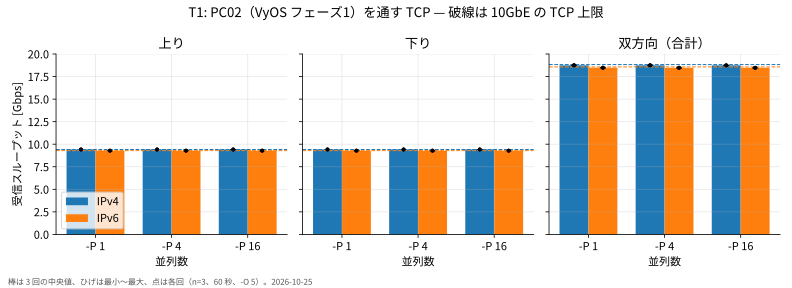
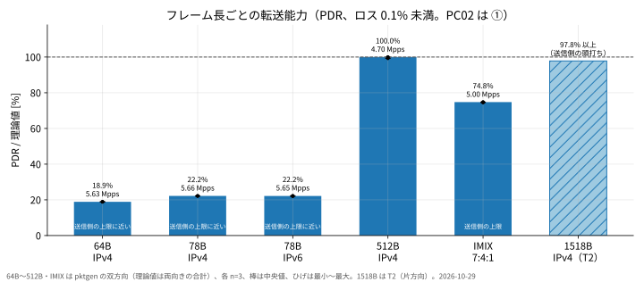
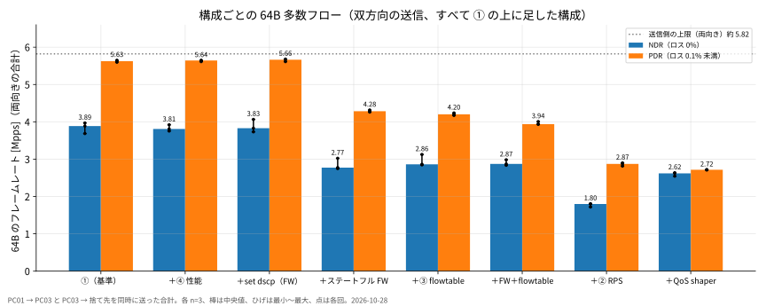
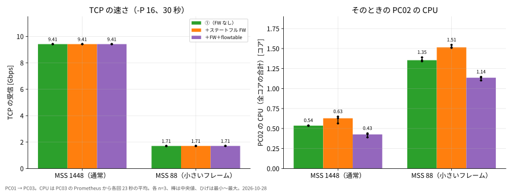
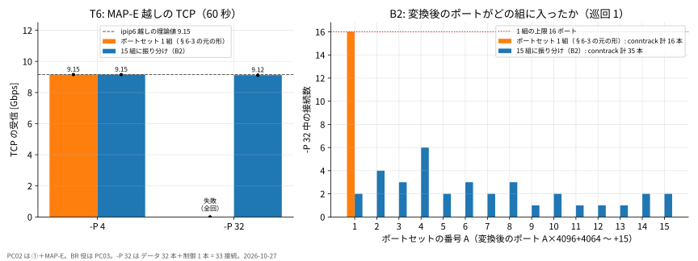
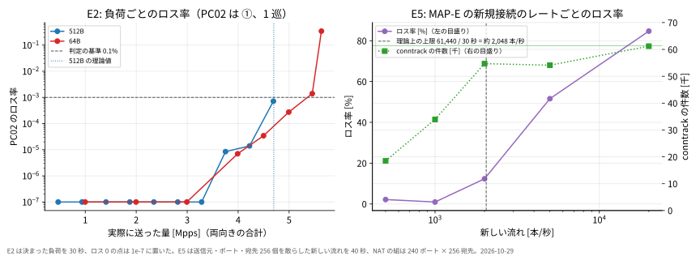
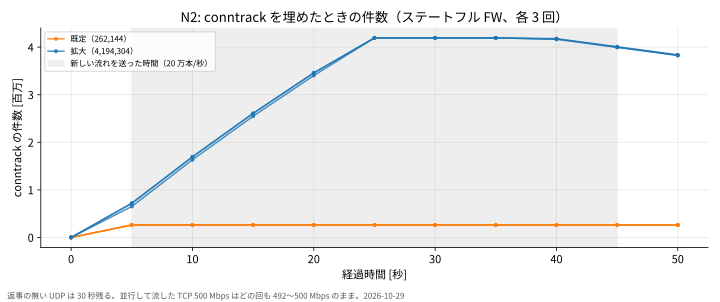
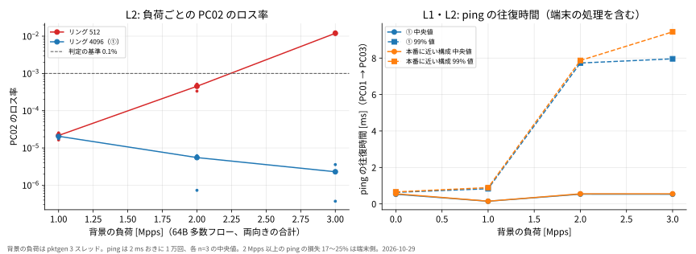
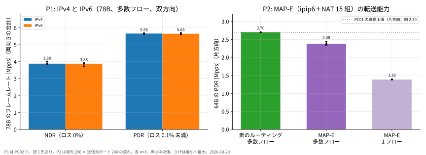

PC02（VyOS）の性能評価
=======================

-	期間: 2026-10-25〜30。試験の後、PC01・PC02・PC03 は基準の状態に戻した
-	対象: PC02（HP ProDesk 400 G7 SFF、Core i5-10500、Intel X710、VyOS 2026.10.16-0024-rolling）
-	図: `results/figures/`（作図は `scripts/plot_results.py`）。各回の生の記録: `results/<試験ID>/<日付>/`

---

総括
----

TCP なら PC02 は 10G を使い切る。64B の小さなパケットでは、10G の理論値の 2 割（両向き 5.6 Mpps）で止まる。家の回線は大きなフレームの TCP が主体なので、本番のルータとして十分に使える。

| 問い | 答え | 根拠 |
|---|---|---|
| TCP は理論値に届くか | 届く。IPv4 9.415 Gbps、IPv6 9.285 Gbps（理論値と一致） | T0・T1 |
| 小さなパケットはどこまで通るか | 64B で両向き 5.63 Mpps（理論値の 18.9%）。512B 以上は理論値の 99〜100% | T3-bidir・P3・E1 |
| どの設定が重いか | QoS の shaper と RPS が約半分に落とす。ステートフル FW は 24% 削る | T3-bidir-configs |
| TCP での FW のコスト | 転送量は変わらない。FW＋flowtable は FW なしより CPU が少ない | T5-tcp |
| IPv6 は遅いか | 差は無い（78B で IPv4 5.66、IPv6 5.65 Mpps） | P1 |
| MAP-E を通しても持つか | TCP 9.155 Gbps（理論値どおり）。ポートセット 15 組を `set` だけで使える | T6・T7・B2・P2 |
| MAP-E の新規の流れの上限 | 約 2,000 本/秒。決めているのは v6プラスのポート数（240 個） | E5 |
| 長時間・過負荷に耐えるか | 60 分でロス 2 × 10⁻⁴。過負荷では転送が約半分に落ち、負荷を下げれば 2 秒以内に戻る | P4・E2・E3・E4 |
| 再起動で何秒止まるか | 約 45 秒止まり、指示から約 49 秒で戻る。設定は残る | R1 |
| 接続はいくつ持てるか | 表を拡大すれば 419 万件。表が埋まっても既存の TCP は落ちない | N1・N2 |
| 遅延 | この方法では PC02 の遅延を切り分けられなかった | L1・L2 |

### 結果から決めた本番の設定

| 決めたこと | 理由 |
|---|---|
| DSCP の書き換えは firewall の set dscp で行う | QoS の shaper は PDR を 48% に落とす。set dscp はコストが測れないほど小さい |
| RPS は入れない | X710 の RSS で既に分かれていて、RPS は分け直しの手間だけ増やす（PDR 51%） |
| リングバッファは 4096 | 512 のままだと散発的に落とす。4096 なら 0.1 秒（58 万個）のバーストを吸収する |
| ステートフル FW には flowtable を添える | TCP では FW なしより CPU が少ない |
| conntrack の表を拡大する | 既定の 26 万件では、新しい流れの多い使い方で埋まる |

どれも `set` だけで書け、実機の PC02 で効くことを確かめた。

---

1 何を検証したか
----------------

### 環境

```
PC01（送信） ──10G── PC02（VyOS） ──10G── PC03（受信・BR 役）
```

-	すべて直結。ルータは PC02 の 1 台だけ（機材は `CLAUDE.md` §2、アドレスは §3）。
-	基準の構成 ① は、フェーズ 1（素のルーティング）＋オフロード＋リング 4096（`vyos/phase1.cmds`＋`vyos/tuning-1-offload.cmds`）。ほかの構成は ① に足したもので、1 つだけ足したもの（＋④、＋ステートフル FW など）と、組み合わせたもの（＋FW＋flowtable、T4 の ①②・①②③・①〜④ の積み上げ、T4b の ①②④）がある。組み合わせの値は、1 つの設定の効果として読まない。

### 測り方

| 対象 | 方法 |
|---|---|
| UDP の上限 | pktgen。RFC 2544 の二分探索で NDR（ロス 0%）と PDR（ロス 0.1% 以下）を求める（付録 B）。探索は 1 回 10 秒、最後の確認は 60 秒 |
| ロス | 送信側の NIC が送った数 − PC02 が送った数。PC02 が落とした数だけを数える |
| 双方向 | PC01 → PC03 と、PC03 → 捨て先（`192.168.10.99`）を同時に送る。値は両向きの合計 |
| TCP | iperf3 3.16、60 秒、最初の 5 秒は捨てる |
| 回数 | 断りが無ければ各条件 3 回、代表値は中央値 |

### 送る側の上限

64B では、PC02 より先に送信機の CPU が 100% に張り付く（`results/sender/20261027/sender.csv`）。

| 送信機 | スレッド 1 | スレッド 2 | スレッド 4 |
|---|---|---|---|
| PC01（i5-7500） | 1.04〜1.12 Mpps | 2.02〜2.17 Mpps | 2.60〜2.92 Mpps |
| PC03（Ryzen 7 5700G） | 1.66〜2.28 Mpps | 2.31〜2.43 Mpps | 2.90〜2.91 Mpps |

-	範囲の下はバースト 1、上はバースト 32。
-	片方向は約 2.70 Mpps、双方向は約 5.82 Mpps が上限。結果がこれに近いときは、PC02 の上限は「その値以上」としか言えない。

### 検証項目

| 目的 | 試験 | 根拠 | 状態 |
|---|---|---|---|
| 大きなフレームの転送 | T0（PC02 で終端）、T1（TCP のルーティング）、T2（UDP 1518B・512B） | RFC 6349・RFC 2544 26.1 | 済 |
| 小さなフレームの上限 | T3・T3-bidir（64B）、P1（IPv6 78B）、P3（512B・IMIX）、E1（128〜1518B） | RFC 2544 26.1・RFC 5180・RFC 6985 | 済 |
| 設定ごとのコスト | T4・T4b（チューニング）、T5-B1・T8（FW・DSCP）、T3-bidir-configs（双方向）、T5-tcp（TCP） | ― | 済 |
| MAP-E | T6（TCP）、T7（Next Header・MSS・PMTUD）、B2（ポートセット）、P2（64B）、E5（新規の流れ） | RFC 9411 | 済 |
| 負荷への耐性 | P4（60 分）、E2（ロス率の曲線）、E3（バースト）、E4（過負荷からの戻り）、R1（再起動） | RFC 2544 26.3〜26.6 | 済 |
| 接続の数 | N1（新規接続の速度）、N2（同時接続数） | RFC 9411 | 済 |
| 遅延 | L1（無負荷）、L2（負荷時） | RFC 2544 26.2・RFC 8239 | 一部 |

---

2 結果
------

### 2-1 TCP（T0・T1）

| 条件 | IPv4 [Gbps] | IPv6 [Gbps] | PC02 の最大コア |
|---|---|---|---|
| 理論値（MSS 1448、タイムスタンプ込み） | 9.415 | 9.285 | ― |
| PC02 で終端（T0、`-P 4`） | 9.415 | ― | ― |
| PC02 を経由、片方向（並列 1/4/16、上り・下り） | 9.415 | 9.285 | 7〜12% |
| PC02 を経由、双方向 | 18.74〜18.77 | 18.44〜18.50 | 12〜26% |

-	全条件・全回で理論値に一致した。PC02 のロスは 0.1% 未満。
-	CPU は最大でも 1 コアの 26%。TCP では PC02 に余裕がある。



### 2-2 フレーム長ごとの上限（T2・T3-bidir・P1・P3・E1）

| フレーム | NDR [Mpps] | PDR [Mpps] | PDR / 理論値 | 律速 |
|---|---|---|---|---|
| 64B 1 フロー | 1.07 | 1.22 | 4.1% | PC02（受信が 1 コアに載る） |
| 64B 多数フロー | 3.89 | 5.63 | 18.9% | PC02（送信側の上限に近い） |
| 78B 多数フロー（IPv4 / IPv6） | 3.88 | 5.66 / 5.65 | 22.2% | 同上 |
| 128B 多数フロー | 3.76 | 5.34 | 31.6% 以上 | 送信側 |
| 256B 多数フロー | 3.91 | 5.24 | 57.8% 以上 | 送信側 |
| 512B 多数フロー | 3.87 | 4.70 | 100.0% | ― |
| 1024B 多数フロー | 2.38 | 2.38 | 99.2% | ― |
| 1280B 多数フロー | 1.92 | 1.92 | 100.0% | ― |
| 1518B 多数フロー | 1.61 | 1.61 | 99.2% | ― |
| IMIX（7:4:1） | 4.99 | 5.00 | 74.8% 以上 | 送信側 |

双方向、PC02 は ①。

-	**512B 以上は理論値まで通る。** 律速するのは小さなフレームだけ。
-	**64B は 5.6 Mpps で止まる。** これは送信側の上限（5.82 Mpps）のすぐ下で、PC02 の本当の上限はまだ見えていない。
-	**1 フローは 1.22 Mpps。** RSS で 1 つの受信キュー（1 コア）にしか載らないため、多数フローの 1/5 になる。
-	**リングバッファが効く。** 最初の試験（リング 512）では、64B 多数フローの NDR が 0.49 Mpps だった。4096 にすると送信側の上限まで伸びた。



図は 10-29 までの値で、E1（128・256・1024・1280・1518B）は入っていない。斜線の棒は送信側が頭打ち。

### 2-3 設定ごとのコスト（T3-bidir-configs・T5-tcp）

64B 多数フロー、双方向。

| 構成（① に足す） | PDR [Mpps] | ① との比 |
|---|---|---|
| ①（基準） | 5.63 | 100% |
| ＋④ 性能プロファイル | 5.64 | 100% |
| ＋firewall の set dscp | 5.66 | 101% |
| ＋ステートフル FW | 4.28 | 76% |
| ＋③ flowtable | 4.20 | 75% |
| ＋FW＋flowtable | 3.94 | 70% |
| ＋② RPS | 2.87 | 51% |
| ＋QoS の shaper（set-dscp） | 2.72 | 48% |



TCP（`-P 16`、30 秒、最初の 5 秒は捨てる。付録 B）では、転送量は変わらず CPU に差が出た。

| 構成 | MSS 1448 [Gbps] | PC02 の CPU（MSS 1448 / 88）[コア] |
|---|---|---|
| ① | 9.41 | 0.54 / 1.35 |
| ＋ステートフル FW | 9.41 | 0.63 / 1.51 |
| ＋FW＋flowtable | 9.41 | 0.43 / 1.14 |



-	**DSCP の書き換えは、書き方でコストがまったく違う。** QoS の shaper は全パケットを HTB に通すので半分に落ちる。firewall の set dscp は差が測れない。
-	**RPS は逆効果。** 多数フローは RSS で既に分かれている。1 フローでは、RPS と性能プロファイルを合わせた構成（T4b の ①②④）が PDR を 1.00 → 1.34 Mpps に上げたが、RPS だけの値は測っていない。本番は多数フローなので入れない。
-	**flowtable は UDP の試験では効かない。** 片方向の UDP は established にならず、flowtable に乗らない。TCP では乗り、FW なしより CPU が 2 割減った。
-	**ステートフル FW の 64B でのコストは 24%。** TCP では CPU が約 1 割増えるだけ。
-	shaper の書き換え自体は正しく効いた（UDP 51820 の IPv6 だけが 0x00 になり、51821 は 0x88 のまま。`results/T8/20261027/dscp-rewrite-check.txt`）。

### 2-4 IPv6（P1）

| 版 | NDR [Mpps] | PDR [Mpps] |
|---|---|---|
| IPv4 | 3.88 | 5.66 |
| IPv6 | 3.88 | 5.65 |

78B、多数フロー、双方向。IPv6＋UDP は 64B に収まらないので、RFC 5180 にならって両方 78B にそろえた。

-	IPv6 の見出しは 20 バイト長いが、転送能力に差は無い。

### 2-5 MAP-E（T6・T7・B2・P2・E5）

| 項目 | ポートセット 1 組 | 15 組に振り分け（本番の形） |
|---|---|---|
| TCP `-P 4` | 9.155 Gbps | 9.154 Gbps |
| TCP `-P 32`（33 接続） | 失敗（17 本目でポートが尽きる） | 9.123 Gbps |
| 使われたポートの組 | A=1 の 16 個だけ | 15 組すべて |
| 外側の Next Header | IPIP（4）が 400/400 | 同じ |
| SYN の MSS | 1420 が 10/10 | 同じ |
| PMTUD | 1432 バイトは通り、1472 バイトで mtu 1460 が返る | 同じ |

| 64B（片方向） | PDR [Mpps] |
|---|---|
| 素のルーティング（送信側の上限） | 2.70 |
| MAP-E、多数フロー | 2.38 |
| MAP-E、1 フロー | 1.39 |

| 新しい流れ [本/秒] | 500 | 1,000 | 2,000 | 5,000 | 20,000 |
|---|---|---|---|---|---|
| ロス率 | 2.2% | 0.97% | 12.3% | 51.6% | 84.7% |
| conntrack の件数 | 18,494 | 33,941 | 54,709 | 54,127 | 61,214 |



-	**TCP は ipip6 越しの理論値（9.155 Gbps）に届く。** プロトコルの動作も実際の BR に合っている。
-	**ポートセット 15 組を `set` だけで使える**（B2、`vyos/mape-portsets.cmds`）。送信元ポートを 16 個ずつの塊に切り、塊の番号を 15 で割った余りで 15 本の SNAT ルールに振り分けた。1 組のままでは 16 接続で尽きる。
-	**64B は素のルーティングの 88% 以上。** 包む処理と NAT のコストは小さい。
-	**新しい流れは約 2,000 本/秒で頭打ち。** 240 ポート × 宛先 256 個 = 61,440 組を、返事の無い UDP が 30 秒占める（61,440 ÷ 30 ≈ 2,048）。上限を決めているのは PC02 ではなく v6プラスの割り当てである。
-	上限より下でも毎秒約 10 本が登録に失敗した（conntrack の `insert_failed`）。複数のコアが同じポートを同時に選んでぶつかるため。MAP-E 多数フローの NDR が 0.05〜0.33 Mpps とばらつくのも同じ理由で、転送能力の問題ではない。

### 2-6 負荷への耐性（P4・E2・E3・E4・R1）

**60 分の連続運転（P4）**: 本番に近い構成（①＋ステートフル FW＋flowtable＋firewall の set dscp）に、64B 多数フローを双方向で 3.545 Mpps（PDR の 9 割）。

| 項目 | 結果 |
|---|---|
| ロス率（60 分の合計） | 1.94 × 10⁻⁴（1 分ごとでも 1.0〜2.8 × 10⁻⁴） |
| PC02 の CPU | 平均 4.3 コア、最大 6.2 コア |
| CPU のパッケージ温度 | 平均 70 ℃、最大 82 ℃ |

**負荷ごとのロス率（E2、3 巡の中央値）**

| 64B の負荷（両向き）[Mpps] | 1.0〜3.0 | 4.0 | 4.5 | 5.0 | 5.5 | 上限超え（5.66） |
|---|---|---|---|---|---|---|
| ロス率 | 0 | 1.8 × 10⁻⁶ | 7.4 × 10⁻⁵ | 3.6 × 10⁻⁴ | 1.3 × 10⁻³ | 3.5 × 10⁻¹ |

| 512B の負荷（理論値に対して） | 10〜70% | 80% | 90% | 100% |
|---|---|---|---|---|
| ロス率 | 0 | 0 | 3.1 × 10⁻⁵ | 7.2 × 10⁻⁴ |

**バースト（E3）**: 両向き約 5.8 Mpps（上限を少し超える）で、決まった数を一気に送った。

| バーストの長さ | 0.01 秒 | 0.03 秒 | 0.1 秒 | 0.3 秒 | 1 秒 | 3 秒 |
|---|---|---|---|---|---|---|
| ロス率 リング 512 | 15.6% | 9.9% | 5.0% | 6.8% | 9.2% | 11.5% |
| ロス率 リング 4096 | 0 | 0 | 0 | 0.11% | 0.28% | 0.28% |

**過負荷からの戻り（E4）**: 送れるだけ（約 5.8 Mpps）を約 20 秒送り、止めずに 2.8 Mpps へ下げた。

| 回 | 上限近くで転送した秒数 | 落ちた後の転送 | 2.8 Mpps に下げた後 |
|---|---|---|---|
| 1 | 7 秒 | 2.8〜3.2 Mpps | 2 秒以内に戻る |
| 2 | 6 秒 | 2.9〜3.6 Mpps | 2 秒以内に戻る |
| 3 | 6 秒 | 2.8〜3.9 Mpps | 2 秒以内に戻る |

**再起動（R1）**: `reboot now` の最中に、64B を 100,000 pps で送り続けた。

| 回 | 転送が止まるまで | 止まっていた時間 | 転送が戻るまで | SSH が戻るまで |
|---|---|---|---|---|
| 1 | 4.4 秒 | 44.1 秒 | 48.5 秒 | 60.5 秒 |
| 2 | 4.3 秒 | 45.1 秒 | 49.4 秒 | 65.9 秒 |
| 3 | 3.4 秒 | 45.1 秒 | 48.5 秒 | 58.7 秒 |

秒数は再起動の指示から。3 回とも、保存した設定のまま戻った。



-	**長時間でも悪くならない。** 60 分のロス率は最初の 10 分と最後の 10 分で同じ（2.01 と 1.99 × 10⁻⁴）。
-	**0.1% を超えるのは 64B で 5.0〜5.5 Mpps のあいだ。** 3 Mpps まではロス 0。512B は理論値の 100% でも基準に収まる。
-	**リング 4096 は瞬間的なあふれを吸収する。** 0.1 秒までのバーストはロス 0。リング 512 は最も短いバーストから 15.6% 落とす。
-	**過負荷が 6〜7 秒続くと、転送が約半分に落ちる。** 過負荷のあいだは戻らない。負荷が下がれば 2 秒以内に戻る（2 秒は 1 秒ごとの値で見分けられる限界）。T3-bidir でも、制限なしで 60 秒送ると、送信 5.82 Mpps に対して転送は 3.30 Mpps（ロス 43.3%）だった。なぜ半分に落ちるかは調べていない。
-	**再起動では約 45 秒止まる。** 管理系の SSH は、転送が戻ってから 10〜16 秒遅れて戻る。

### 2-7 接続の数（N1・N2）

| 構成 | 新しい流れの送信 [Mpps] | 最大の件数 | メモリ | 並行 TCP の最小 |
|---|---|---|---|---|
| ①（FW なし） | 1.96 | ― | ― | ― |
| ＋ステートフル FW（表は既定） | 1.93 | 262,143 | 64 MB | 496 Mbps |
| ＋ステートフル FW（表を拡大） | 1.99 | 4,194,299 | 1,024 MB | 493 Mbps |



-	**1 秒に約 175〜186 万本の新規接続を作れる**（表を拡大した構成で、1 秒送った直後の件数）。FW の有無で差が無く、送信側の上限（約 2 Mpps）に重なるので、PC02 の上限はまだ見えていない。
-	**表が埋まっても、既存の接続は落ちない。** 返事の無い古い流れから捨てて（early_drop）空きを作る。20 万本/秒を 40 秒送って、新しい接続の失敗は 289 件。並行して流した 500 Mbps の TCP は落ちなかった。
-	**表の拡大は `set` で書ける**（`set system conntrack table-size '4194304'`、`hash-size '1048576'`。`vyos/conntrack-large.cmds`）。1 件あたり約 256 バイト。

### 2-8 遅延（L1・L2）

| 背景の負荷（両向き） | PC02 のロス率 リング 512 / 4096 | ping 中央値 [ms] | ping 99% 値 [ms] | ping の損失 |
|---|---|---|---|---|
| 0 | ― | 0.528 | 0.632 | 0% |
| 1.0 Mpps | 2 × 10⁻⁵ / 2 × 10⁻⁵ | 0.145 | 0.831 | 0% |
| 2.0 Mpps | 4.5 × 10⁻⁴ / 6 × 10⁻⁶ | 0.534 | 7.73 | 17.3% |
| 3.0 Mpps | 1.2 × 10⁻² / 3 × 10⁻⁶ | 0.530 | 7.96 | 25.2% |

ping は PC01 → PC03 を 2 ms おきに 1 万回（構成 ①）。本番に近い構成でも、どの値も ① との差は小さい（負荷 0 の中央値で約 0.02 ms）。



-	**リング 4096 は、2 Mpps 以上の負荷で PC02 のロスを減らす。** リング 512 と比べて、2.0 Mpps で約 1/75、3.0 Mpps で約 1/4,000。1.0 Mpps では差が無い。
-	**ping の悪化は、PC02 ではなく送信を兼ねる端末で起きている。** 2 Mpps 以上での損失と 99% 値の悪化は、PC02 のロス率と関係なく、2 つの構成で同じように出た。
-	PC02 そのものの遅延は、この方法では読み取れない。正確に測るには、時刻を付けられる試験機か、遅延だけを測る別の端末が要る。

---

3 測れていないこと
------------------

| 項目 | 状態 | 足りないもの |
|---|---|---|
| 64B・128B・256B・IMIX の本当の上限 | 送信側で頭打ち | 送信機を増やすか、速い送信機 |
| 正確な遅延・負荷時の遅延（RFC 2544 26.2・RFC 8239） | 一部 | 時刻を付けられる試験機 |
| 本来の back-to-back（RFC 2544 26.4） | 近似のみ | ワイヤーレートを出せる送信機 |
| 過負荷で転送が半分に落ちる理由 | 未解明 | どこで詰まるかの調査 |
| TCP の RTT・BDP（RFC 6349） | 未記録 | 優先度は低い |
| 消費電力 | 未測定 | CPU は RAPL、機体全体はワットチェッカー |
| CPU のコアごとの使用率 | 一部 | 10-29 以降の 30 秒以上の試行だけ記録 |
| NIC の温度 | 測れない | X710 が温度を出さない |

性能以外では、SFP+ モジュールと配線の確認（A1〜A3）、実回線での MAP-E と DSCP の書き換え、DHCPv6-PD の模擬（B3）、プレフィックスの変化への追従、NixOS との比較（`CLAUDE.md` §7）が残っている。

---

付録 A 各回の値
---------------

### T0（PC02 で終端、`-P 4`）

| 条件 | 受信 [Gbps] | 再送（各回） | ロス |
|---|---|---|---|
| PC01 → PC02 | 9.415 | 41 / 39 / 14 | 0 |
| PC03 → PC02 | 9.415 | 78 / 61 / 10 | 0 |

### T1（PC01 ⇄ PC03、PC02 を経由）

| 版 | 並列 | 向き | 受信 [Gbps]（1 / 2 / 3 回目） | 再送（各回） | PC02 の最大コア |
|---|---|---|---|---|---|
| IPv4 | 1 | 上り | 9.415 / 9.415 / 9.415 | 27 / 14 / 63 | 12% |
| IPv4 | 1 | 下り | 9.415 / 9.415 / 9.415 | 90 / 17 / 274 | 12% |
| IPv4 | 1 | 双方向 | 18.747 / 18.768 / 18.740 | 50 / 18 / 1475 | 26% |
| IPv4 | 4 | 上り | 9.415 / 9.415 / 9.415 | 167 / 287 / 212 | 9% |
| IPv4 | 4 | 下り | 9.415 / 9.415 / 9.415 | 75 / 79 / 50 | 11% |
| IPv4 | 4 | 双方向 | 18.760 / 18.746 / 18.746 | 256 / 169 / 403 | 15% |
| IPv4 | 16 | 上り | 9.415 / 9.415 / 9.415 | 52 / 408 / 308 | 10% |
| IPv4 | 16 | 下り | 9.415 / 9.415 / 9.415 | 146 / 72 / 468 | 7% |
| IPv4 | 16 | 双方向 | 18.744 / 18.748 / 18.740 | 2149 / 1873 / 984 | 15% |
| IPv6 | 1 | 上り | 9.285 / 9.285 / 9.285 | 28 / 48 / 11 | 12% |
| IPv6 | 1 | 下り | 9.285 / 9.285 / 9.285 | 0 / 33 / 60 | 12% |
| IPv6 | 1 | 双方向 | 18.458 / 18.496 / 18.484 | 181 / 189 / 70 | 18% |
| IPv6 | 4 | 上り | 9.285 / 9.285 / 9.285 | 251 / 331 / 552 | 12% |
| IPv6 | 4 | 下り | 9.285 / 9.285 / 9.285 | 110 / 260 / 193 | 11% |
| IPv6 | 4 | 双方向 | 18.473 / 18.491 / 18.444 | 353 / 292 / 371 | 20% |
| IPv6 | 16 | 上り | 9.285 / 9.285 / 9.285 | 910 / 245 / 636 | 8% |
| IPv6 | 16 | 下り | 9.285 / 9.285 / 9.285 | 217 / 169 / 272 | 8% |
| IPv6 | 16 | 双方向 | 18.478 / 18.480 / 18.456 | 1548 / 762 / 943 | 12% |

IPv4 の並列 1・双方向の 3 回目に、PC02 の eth1 の `rx_dropped` が 60 個増えた（約 6.6 × 10⁻⁷）。

### T2（iperf3 UDP、片方向）

| 条件 | 送信 [pps] | PC02 の転送 [pps] | PC02 のロス | PC03 の受信のロス |
|---|---|---|---|---|
| 1518B 1 回目 | 792,912 | 792,912 | 0 | 4.3% |
| 1518B 2 回目 | 795,043 | 795,038 | 5 | 4.5% |
| 1518B 3 回目 | 798,396 | 798,396 | 0 | 3.1% |
| 512B 1 回目 | 905,468 | 905,337 | 131 | 5.9% |
| 512B 2 回目 | 909,459 | 909,459 | 0 | 1.4% |
| 512B 3 回目 | 910,526 | 910,523 | 3 | 7.3% |

iperf3 の送信側が頭打ち（1518B は理論値の 97.8%、512B は 38.7%）。上限は pktgen の値（P3・E1）で見る。

### フレーム長（T3-bidir・P1・P3・E1、双方向）

| 試験 | 条件 | NDR [Mpps]（1 / 2 / 3 回目） | PDR [Mpps]（1 / 2 / 3 回目） |
|---|---|---|---|
| T3-bidir | 64B 多数フロー | 3.346 / 3.537 / 3.628 | 5.001 / 4.947 / 5.002 |
| T3-bidir | 64B 1 フロー | 1.074 / 1.074 / 1.071 | 1.210 / 1.226 / 1.217 |
| P1 | 78B IPv4 | 4.009 / 3.873 / 3.884 | 5.663 / 5.684 / 5.632 |
| P1 | 78B IPv6 | 3.882 / 3.920 / 3.720 | 5.652 / 5.695 / 5.606 |
| P3 | 512B | 3.790 / 3.867 / 3.886 | 4.699 / 4.699 / 4.663 |
| P3 | IMIX | 4.992 / 4.982 / 4.986 | 5.002 / 5.000 / 4.979 |
| E1 | 128B | 3.757 / 3.715 / 3.897 | 5.335 / 5.343 / 5.278 |
| E1 | 256B | 3.993 / 3.907 / 3.751 | 5.237 / 5.238 / 5.190 |
| E1 | 1024B | 2.376 / 2.376 / 2.376 | 2.376 / 2.371 / 2.376 |
| E1 | 1280B | 1.923 / 1.923 / 1.923 | 1.923 / 1.923 / 1.904 |
| E1 | 1518B | 1.613 / 1.613 / 1.609 | 1.613 / 1.613 / 1.613 |

### 最初の片方向の試験（T3、リング 512、各 1 回）

| 条件 | NDR [Mpps] | PDR [Mpps] | 制限なしで送ったとき |
|---|---|---|---|
| 64B 1 フロー | 0.515 | 0.819 | 送信 2.835 に対し転送 1.285（ロス 54.7%） |
| 64B 多数フロー | 0.490 | 1.794 | 送信 2.836 に対し転送 2.784（ロス 1.80%） |

### 構成ごと（T3-bidir-configs、64B 多数フロー、双方向）

| 構成 | NDR [Mpps]（1 / 2 / 3 回目） | PDR [Mpps]（1 / 2 / 3 回目） |
|---|---|---|
| ① | 3.686 / 3.887 / 3.969 | 5.648 / 5.626 / 5.597 |
| ＋④ 性能プロファイル | 3.921 / 3.754 / 3.809 | 5.643 / 5.612 / 5.645 |
| ＋firewall の set dscp | 4.065 / 3.732 / 3.829 | 5.664 / 5.612 / 5.680 |
| ＋ステートフル FW | 2.774 / 2.749 / 3.024 | 4.316 / 4.261 / 4.283 |
| ＋③ flowtable | 3.125 / 2.848 / 2.862 | 4.237 / 4.202 / 4.173 |
| ＋FW＋flowtable | 2.836 / 2.983 / 2.872 | 4.006 / 3.939 / 3.935 |
| ＋② RPS | 1.799 / 1.719 / 1.806 | 2.872 / 2.816 / 2.900 |
| ＋QoS の shaper | 2.637 / 2.545 / 2.619 | 2.716 / 2.712 / 2.716 |

### 構成ごと、片方向（T4・T4b・T5-B1・T8）

片方向の多数フローは送信側の上限（2.70 Mpps）に張り付き、構成の差が見えない。構成の比較には双方向の値を使う。

T4（① から ④ を順に積み上げ、各 1 回、10-25）

| 段階 | 1 フロー NDR | 1 フロー PDR | 多数フロー NDR | 多数フロー PDR |
|---|---|---|---|---|
| 基準（リング 512） | 0.515 | 0.819 | 0.490 | 1.794 |
| ① リング 4096 | 0.877 | 0.977 | 1.797 | 2.693 |
| ①② ＋RPS | 0.604 | 1.374 | 1.384 | 2.451 |
| ①②③ ＋flowtable | 0.456 | 2.696 | 1.062 | 1.806 |
| ①〜④ ＋性能プロファイル | 2.639 | 2.667 | 1.169 | 1.827 |

T4b（構成を 4 つに絞り 3 巡、10-26）

| 構成 | 1 フロー NDR | 1 フロー PDR | 多数フロー NDR | 多数フロー PDR |
|---|---|---|---|---|
| 基準（リング 512） | 0.516 / 0.358 / 0.588 | 0.764 / 0.787 / 0.804 | 0.976 / 0.724 / 0.974 | 1.792 / 1.760 / 1.791 |
| ① | 0.885 / 0.868 / 0.877 | 1.052 / 0.998 / 0.978 | 2.688 / 2.695 / 2.706 | 2.595 / 2.708 / 2.702 |
| ①④ | 0.881 / 0.885 / 0.798 | 0.998 / 0.993 / 0.979 | 2.708 / 2.708 / 1.979 | 2.685 / 2.686 / 2.699 |
| ①②④ | 1.059 / 1.037 / 0.505 | 1.342 / 1.343 / 1.344 | 1.501 / 1.544 / 1.578 | 2.435 / 2.458 / 2.414 |

T5-B1・T8（10-27）

| 構成 | 1 フロー NDR | 1 フロー PDR | 多数フロー NDR | 多数フロー PDR |
|---|---|---|---|---|
| ①（T5-B1） | 0.876 / 0.815 / 0.889 | 0.975 / 0.986 / 0.990 | 2.710 / 2.698 / 2.673 | 2.690 / 2.685 / 2.701 |
| ＋ステートフル FW | 0.736 / 0.462 / 0.707 | 0.846 / 0.827 / 0.815 | 2.479 / 2.472 / 2.600 | 2.685 / 2.703 / 2.709 |
| ＋FW＋flowtable | 1.612 / 1.248 / 1.347 | 1.807 / 1.784 / 1.777 | 2.281 / 2.015 / 2.174 | 2.701 / 2.703 / 2.698 |
| ＋firewall の set dscp | 0.883 / 0.888 / 0.882 | 1.020 / 1.038 / 1.002 | 2.690 / 2.684 / 2.712 | 2.710 / 2.689 / 2.696 |
| ①（T8） | 0.876 / 0.875 / 0.816 | 0.969 / 0.998 / 0.985 | 2.709 / 2.684 / 2.692 | 2.700 / 2.703 / 2.708 |
| ＋QoS の shaper | 0.780 / 0.773 / 0.782 | 0.898 / 0.870 / 0.892 | 1.371 / 1.372 / 1.366 | 1.402 / 1.407 / 1.396 |

-	FW＋flowtable は、1 フローで ① より速かった（PDR 0.99 → 1.78）。flowtable に乗ったのは 1,769 個だけで、理由は分かっていない。
-	QoS の shaper を付けても、TCP は IPv4 9.415 / IPv6 9.285 Gbps のまま（PC02 の最大コア 8〜12%）。

### T5-tcp

| 構成 | MSS | 受信 [Gbps]（1 / 2 / 3 回目） | PC02 の CPU 合計 [コア]（1 / 2 / 3 回目） |
|---|---|---|---|
| ① | 1448 | 9.415 / 9.415 / 9.415 | 0.54 / 0.54 / 0.53 |
| ① | 88 | 1.708 / 1.695 / 1.706 | 1.39 / 1.34 / 1.35 |
| ＋ステートフル FW | 1448 | 9.415 / 9.415 / 9.415 | 0.63 / 0.65 / 0.56 |
| ＋ステートフル FW | 88 | 1.698 / 1.709 / 1.710 | 1.51 / 1.51 / 1.55 |
| ＋FW＋flowtable | 1448 | 9.415 / 9.415 / 9.415 | 0.43 / 0.39 / 0.44 |
| ＋FW＋flowtable | 88 | 1.709 / 1.703 / 1.709 | 1.10 / 1.14 / 1.15 |

MSS 88 の 1.71 Gbps は端末の上限。flowtable に乗った接続は 17 / 17。

### MAP-E（T6・P2）

| 構成 | 条件 | 受信 [Gbps]（1 / 2 / 3 回目） | 再送 中央値 |
|---|---|---|---|
| ポートセット 1 組 | `-P 4` | 9.155 / 9.155 / 9.155 | 851 |
| ポートセット 1 組 | `-P 32` | 失敗 / 失敗 / 失敗（90 秒で打ち切り） | ― |
| 15 組に振り分け | `-P 4` | 9.154 / 9.155 / 9.142 | 962 |
| 15 組に振り分け | `-P 32` | 9.123 / 9.096 / 9.125 | 31,519 |

| 条件（64B、片方向） | NDR [Mpps]（1 / 2 / 3 回目） | PDR [Mpps]（1 / 2 / 3 回目） |
|---|---|---|
| 素のルーティング、多数フロー | 2.696 / 2.683 / 2.680 | 2.697 / 2.701 / 2.699 |
| MAP-E、多数フロー | 0.078 / 0.047 / 0.327 | 2.440 / 2.377 / 2.346 |
| MAP-E、1 フロー | 0.502 / 1.139 / 1.159 | 1.386 / 1.386 / 1.391 |

P2 の多数フローは、宛先 256 個 × 送信元ポート 240 個。E5 は ①＋MAP-E（15 組）で、送信元 241 アドレス × ポート × 宛先 256 個に散らした新しい流れを 40 秒（各 1 回）。



### E2 の 3 巡の範囲

| 64B の負荷 [Mpps] | 1.0〜3.0 | 4.0 | 4.5 | 5.0 | 5.5 | 上限超え |
|---|---|---|---|---|---|---|
| 範囲 | 0 | 0〜1.4 × 10⁻⁵ | 3.3〜8.3 × 10⁻⁵ | 3.1〜4.0 × 10⁻⁴ | 1.3〜1.4 × 10⁻³ | 3.4〜3.5 × 10⁻¹ |

| 512B の負荷 | 10〜70% | 80% | 90% | 100% |
|---|---|---|---|---|
| 範囲 | 0 | 0〜7.8 × 10⁻⁶ | 1.3〜5.1 × 10⁻⁵ | 7.0〜8.9 × 10⁻⁴ |

### N1（新しい流れの送信、各回）

| 構成 | 送信 [Mpps]（1 / 2 / 3 回目） | 1 秒後の conntrack の件数 |
|---|---|---|
| ①（FW なし） | 1.962 / 1.900 / 2.040 | ― |
| ＋ステートフル FW（既定） | 1.930 / 1.942 / 1.915 | 上限の約 26 万で止まる |
| ＋ステートフル FW（拡大） | 1.985 / 1.987 / 2.059 | 1,785,747 / 1,858,552 / 1,747,961 |

送信元 241 アドレス × ポート 64,512 個から、パケットごとにランダムに選ぶ 64B の UDP。試行ごとに conntrack を空にして 1 秒送った。

### L1・L2（本番に近い構成の値）

| 背景の負荷 | ping 中央値 [ms] | ping 99% 値 [ms] | ping の損失 |
|---|---|---|---|
| 0 | 0.556 | 0.658 | 0% |
| 1.0 Mpps | 0.147 | 0.892 | 0% |
| 2.0 Mpps | 0.552 | 7.87 | 17.1% |
| 3.0 Mpps | 0.552 | 9.44 | 24.4% |
| 上限超え（① / 本番に近い構成） | 0.527 / 0.550 | 31,081 / 31,227 | 34.0% / 33.8% |

---

付録 B 測り方の注記
-------------------

-	**PDR の境界**: `CLAUDE.md` §8 は合否の基準を「ロス率 0.1% 未満」としているが、`scripts/t3_search.py` はロス率がちょうど 0.1% の点も合格にする（`dut_loss_ratio <= loss_tolerance`）。表の PDR はこの判定で求めた値。
-	**T5-tcp の時間**: §8 の「60 秒を 3 回」と違い、各回 30 秒（`-t 30 -O 5 -P 16`、3 回）。最初の 5 秒は捨てている。
-	**NIC のカウンタ**: `CLAUDE.md` §8 は試験の前後で `ethtool -S` の全項目を保存するとしている。pktgen の試験（`scripts/t3_search.py`）は、ロスの判定に使う 4 つ（PC01 の送信、PC02 の受信と送信、PC03 の受信）だけを各試行の JSON（`final_counters`）に残した。
-	**T3-bidir と T3-bidir-configs の ①**: 同じ構成で、PDR は 5.00（10-27）と 5.63（10-28）だった。差の理由は確かめていない。構成どうしの比較には、同じ日に同じ手順で並べた後者を使う。
-	**E2 の時間**: §8 の「60 秒を 3 回、最初の 5 秒は捨てる」と違い、各点 30 秒で最初の 5 秒は捨てていない。3 巡 × 18 点を 60 秒にすると 1 時間を超えるため。5 秒を捨てる決まりは TCP の立ち上がりのためで、pktgen は最初から決まったレートで送る。30 秒の点はまれなロスを拾いにくいが、0.1% の基準の前後の点は 3 巡とも同じ側に入った。10-29 の 1 巡（`E-extra/20261029/E2`）とも同じ形。
-	**E3 の止め方**: 10-29 の最初の試験は送る時間で止めていて、0.01 秒では送信が止まらず見送った。10-30 は送る数（pktgen の `count`）で止めた（`scripts/run-e3-e4.sh`）。
-	**E4 の値の取り方**: 1 秒ごとの値は、PC03 の Prometheus（1 秒おき）に入った PC02 の eth1＋eth2 の送信数と、PC01・PC03 の sfp0 の送信数から取った。10-29 の最初の試験（`E-extra/20261029/E4`）は過負荷と 50% を別々に流し、あいだに約 25 秒の切れ目があったため、戻りの時間は測れなかった。
-	**R1 の数え方**: 表は `summary.csv` ではなく、各回の `pc03-rx.txt`（1 秒ごとの受信数）から数え直した値。
	1.	再起動の指示より前の 1 秒ごとの受信数の中央値を平常とする（102,400 個/秒）。
	2.	指示の後で、平常の 95% 以上だった最後の秒を「止まった」とする。
	3.	その後で、平常の 95% 以上が 5 秒続いた最初の秒を「戻った」とする。
	-	`summarize_reboot.py` は 5 秒続くかを見ないため、復帰の後に約 48 秒おきに出る 1 秒だけの 0（PC03 の BCM57840 側。同じ時刻の PC02 の eth2 の送信には落ち込みが無い）を数え、「完全復帰」を 350〜362 秒としていた。3 回目の「受信の再開」2.0 秒も、停止の途中に約 6.5 万個が届いた 1 秒を数えた誤り。
	-	最初の 1 巡（`R1-reboot/20261030/invalid-round1-sender-stopped-on-linkdown`）は、送信側の pktgen がリンク断で止まって使えなかった。リンクが戻ったら残りの秒数で送り直す `scripts/pktgen-keepalive.sh` を足して流し直した。
-	**N1 の最初の試験**: pktgen の `clone_skb 1000`（同じパケットを使い回す）のままで流れが新しくならず、使えなかった。`clone_skb 0` で測り直した。
-	**L1・L2 の向き**: 最初は PC03 → PC01 で測り、本番に近い構成ではステートフル FW が WAN からの ICMP を捨てて損失が 100% になった。LAN → WAN の向きで測り直した（`L-latency-lan`）。
-	**`results/` のディレクトリ名**: E1 は `E1-sizes`、E2 は `E-extra`（1 巡、10-29）と `E2-curve`（3 巡、10-30）、E3・E4 は `E-extra/20261029-e3e4`、E5 は `E-extra`、N1・N2 は `C-conn`、R1 は `R1-reboot`、L1 は `L-latency`、L2 は `L-latency-lan`。

---

記録の置き場所
--------------

-	各試験の生の記録（各回の JSON と、試験中の PC02 の設定）: `results/<試験ID>/<日付>/`
-	集計: 各ディレクトリの `summary.csv`（T1・T2・T4 は `runs.csv` も）
-	図: `results/figures/`、作図は `scripts/plot_results.py`
-	試験のスクリプト: `scripts/t3_search.py`（二分探索）、`scripts/pktgen-run.sh`、`scripts/run-*.sh`
-	構成の差分: `vyos/*.cmds`、試験用の捨て先は `vyos/test-sink.cmds`・`vyos/test-sink-fw.cmds`
-	図表つきのまとめ: https://claude.ai/artifact/Qa3MT1vVztZn2Ggy5GLKYD
