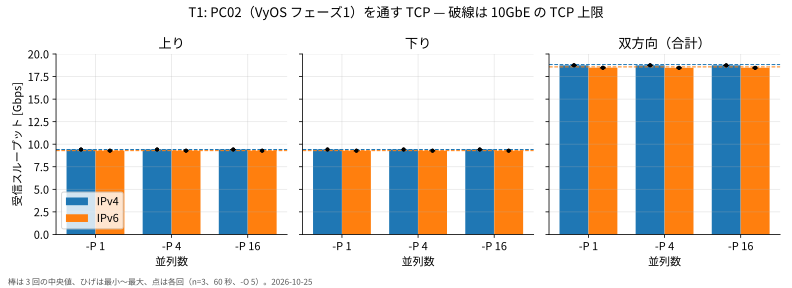
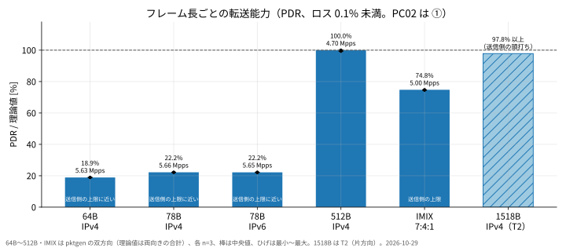
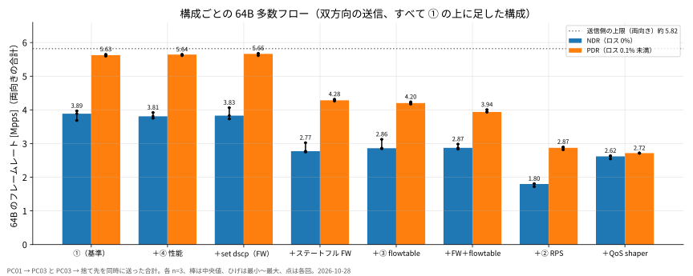
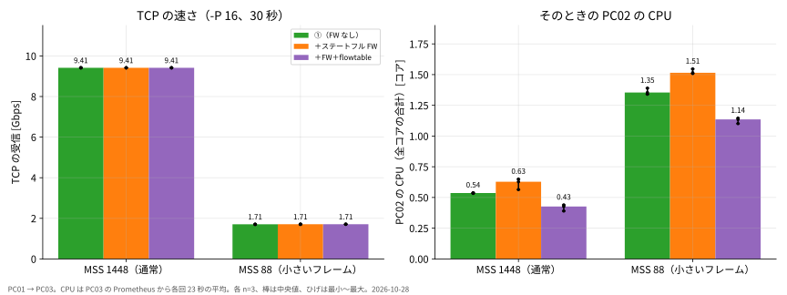
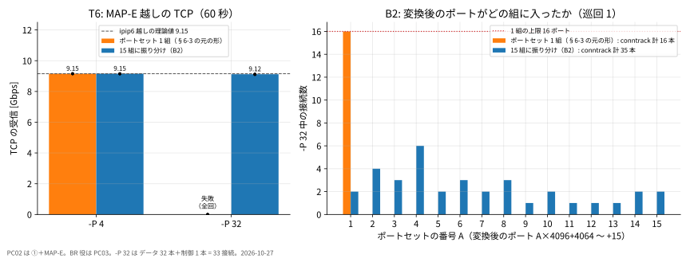
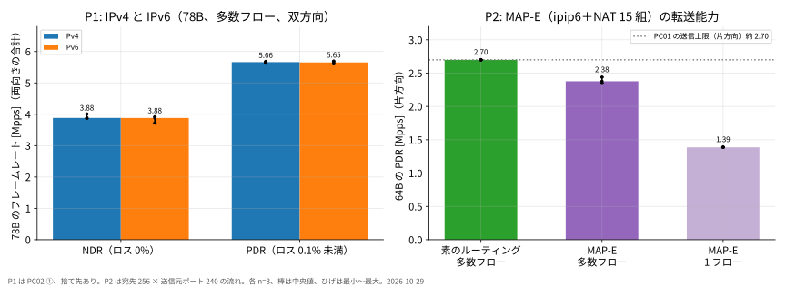
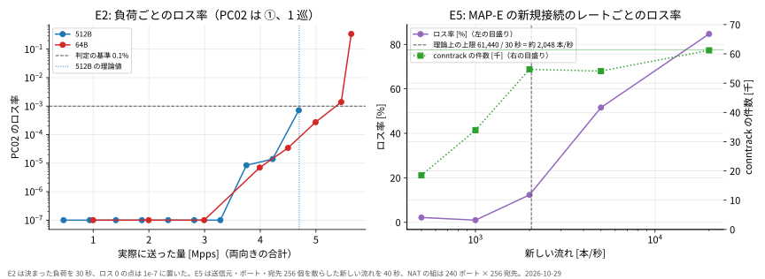
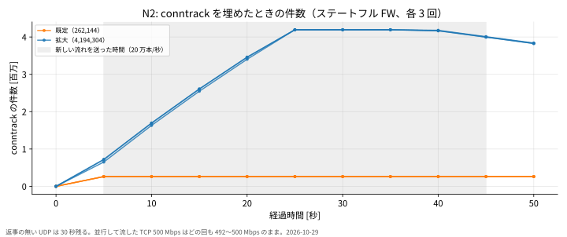
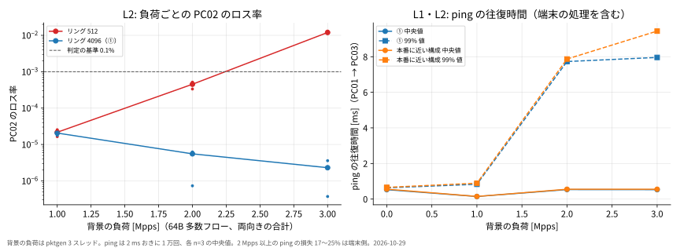

PC02（VyOS）の性能評価
=======================

-	期間: 2026-10-25〜30（最後の試験は 10-30 03:06 に終了。PC01・PC02・PC03 は基準の状態に戻した）
-	対象: PC02（HP ProDesk 400 G7 SFF、Core i5-10500、Intel X710、VyOS 2026.10.16-0024-rolling）
-	図: `results/figures/`（作図は `scripts/plot_results.py`）。各回の生の記録: `results/<試験ID>/<日付>/`

---

TCP を 1 本流すだけなら、PC02 は 10G を使い切る。IPv4 で 9.415 Gbps、IPv6 で 9.285 Gbps。どちらも、ヘッダを差し引いた理論値そのものである。

それなら 10G ルータとして完成している、と言いたくなる。ところが 64 バイトのパケットで同じことをすると、両向きの合計で 5.6 Mpps。10G の理論値の 2 割に届かない。しかもこの 5.6 Mpps は PC02 の上限ではなく、送る側の PC01・PC03 の上限にほぼ重なっている。

速いのか遅いのか。どの設定がどれだけ削るのか。v6プラスの MAP-E を通しても持つのか。この文書は、6 日間の試験の結果を検証項目ごとに並べ、各回（ほとんどの条件で 3 回）の値まで残す。

---

試験の環境と測り方
------------------

```
PC01（送信） ──10G── PC02（VyOS） ──10G── PC03（受信・BR 役）
```

すべて直結で、ルータは PC02 の 1 台だけ。機材の詳細は `CLAUDE.md` の §2、アドレスは §3 にある。

| 項目 | 内容 |
|---|---|
| UDP の計測 | カーネルの pktgen。RFC 2544 の二分探索で、NDR（ロス 0%）と PDR（ロス 0.1% 未満）を求める。探索の 1 回は 10 秒、最後の確認は 60 秒 |
| ロスの数え方 | 送信側の NIC が送った数 − PC02 が送った数。PC02 が落とした数だけを数え、受信側の取りこぼしは含めない |
| 双方向 | PC01 → PC03 と、PC03 → 捨て先（`192.168.10.99`。PC02 は転送するが、受け取る端末は無い）を同時に送る。値は両向きの合計 |
| TCP の計測 | iperf3 3.16、60 秒。最初の 5 秒は捨てる（`-O 5`） |
| 回数 | 断りが無ければ各条件 3 回。代表値は中央値 |
| NIC のカウンタ | `CLAUDE.md` §8 の共通の条件は、試験の前後で `ethtool -S` の全項目を保存するとしている。pktgen の試験（`scripts/t3_search.py`）はこれと違い、ロスの判定に使う 4 つ（PC01 の送信、PC02 の受信と送信、PC03 の受信）だけを、各試行の JSON（`final_counters`）に残す。全項目の前後は残していない |
| 基準の構成 ① | フェーズ 1（素のルーティング）＋オフロード＋リング 4096（`vyos/phase1.cmds`＋`vyos/tuning-1-offload.cmds`）。ほかの構成は、① の上に 1 つずつ足す |

### 送る側の上限

64 バイトで送れる量は、PC02 より先に送信側で頭打ちになる。最初にこれを測った（`results/sender/20261027/sender.csv`）。

| 送信機 | スレッド 1 | スレッド 2 | スレッド 4 |
|---|---|---|---|
| PC01（i5-7500） | 1.04〜1.12 Mpps | 2.02〜2.17 Mpps | 2.60〜2.92 Mpps |
| PC03（Ryzen 7 5700G） | 1.66〜2.28 Mpps | 2.31〜2.43 Mpps | 2.90〜2.91 Mpps |

範囲の下はバースト 1、上はバースト 32。どの組み合わせでも、送信機の CPU は 100% に張り付いた。

-	片方向は約 2.70 Mpps、双方向は約 5.82 Mpps が送信側の上限になる。
-	以下の表で値がこれに近いときは、PC02 の上限は「その値以上」としか言えない。

---

検証項目の一覧
--------------

| ID | 内容 | 根拠 | 状態 |
|---|---|---|---|
| T0 | 端末と PC02 のあいだの TCP（PC02 で終端） | ― | 済 |
| T1 | ルーティング（TCP）。IPv4・IPv6、並列 1/4/16、上り・下り・双方向 | RFC 6349 | 済 |
| T2 | ルーティング（UDP）。1518B と 512B（iperf3） | RFC 2544 26.1 | 済 |
| T3・T3-bidir | 64B の pps の上限。1 フローと多数フロー、片方向と双方向 | RFC 2544 26.1 | 済 |
| T4・T4b | チューニング ①〜④ の効果（片方向） | ― | 済 |
| T5-B1・T8 | ステートフル FW・flowtable・firewall の set dscp・QoS の shaper のコスト（片方向） | ― | 済 |
| T3-bidir-configs | 上の各構成のコスト（双方向） | ― | 済 |
| T5-tcp | ステートフル FW と flowtable の、TCP での CPU のコスト | ― | 済 |
| P1 | IPv6 の転送能力（78B） | RFC 5180 | 済 |
| P2 | MAP-E 越しの 64B の転送能力 | ― | 済 |
| P3 | 512B と IMIX（7:4:1） | RFC 2544・RFC 6985 | 済 |
| T6・T7・B2 | MAP-E 越しの TCP、ポートセット、プロトコルの動作（Next Header・MSS・PMTUD） | ― | 済 |
| P4 | 本番に近い構成での 60 分の連続運転 | ― | 済 |
| E1 | 残りのフレーム長（128・256・1024・1280・1518B、pktgen） | RFC 2544 26.1 | 済 |
| E2 | 負荷ごとのロス率の曲線 | RFC 2544 26.3 | 済（3 巡） |
| E3 | バースト（back-to-back の近似） | RFC 2544 26.4 | 済 |
| E4 | 過負荷からの戻り | RFC 2544 26.5 | 済 |
| E5 | MAP-E の新規の流れの上限 | RFC 9411 | 済 |
| N1・N2 | 新規接続の速度と、同時接続数の上限 | RFC 9411 | 済 |
| R1 | 再起動にかかる時間 | RFC 2544 26.6 | 済 |
| L1・L2 | 遅延と、負荷時の遅延 | RFC 2544 26.2・RFC 8239 | 一部 |

`results/` 上のディレクトリ名との対応: E1 は `E1-sizes`、E2 は `E-extra`（1 巡、10-29）と `E2-curve`（3 巡、10-30）、E3・E4 は `E-extra/20261029-e3e4`（10-29 の `E-extra/20261029/E4` は切れ目のある最初の試験）、E5 は `E-extra`、N1・N2 は `C-conn`、R1 は `R1-reboot`、L1 は `L-latency`、L2 は `L-latency-lan`。

---

1. TCP は理論値に届くか（T0・T1）
---------------------------------

届く。どの並列数でも、どの向きでも届いた。

PC02 自身が相手のとき（T0）も、PC02 を経由するとき（T1）も、片方向は 9.415 Gbps（IPv4）だった。MSS 1448 にタイムスタンプを含めた理論値と、小数第 3 位まで一致している。双方向は 18.7 Gbps（IPv6 は 18.5 Gbps）。PC02 で一番忙しいコアでも、使用率は 26% だった。



**図の読み方**

-	横軸は並列数と向き、縦軸は受信した Gbps。色は IPv4 と IPv6、破線はそれぞれの理論値。
-	すべての棒が破線に届いている。

### T0（PC02 で終端、`-P 4`）

| 条件 | 受信 [Gbps] | 再送（各回） | ロス |
|---|---|---|---|
| PC01 → PC02 | 9.415 | 41 / 39 / 14 | 0 |
| PC03 → PC02 | 9.415 | 78 / 61 / 10 | 0 |

### T1（PC01 ⇄ PC03、PC02 を経由）各回の値

| 版 | 並列 | 向き | 受信 [Gbps]（1 / 2 / 3 回目） | 再送（各回） | PC02 の最大コア |
|---|---|---|---|---|---|
| IPv4 | 1 | 上り | 9.415 / 9.415 / 9.415 | 27 / 14 / 63 | 12% |
| IPv4 | 1 | 下り | 9.415 / 9.415 / 9.415 | 90 / 17 / 274 | 12% |
| IPv4 | 1 | 双方向 | 18.747 / 18.768 / 18.740 | 50 / 18 / 1475 | 26% |
| IPv4 | 4 | 上り | 9.415 / 9.415 / 9.415 | 167 / 287 / 212 | 9% |
| IPv4 | 4 | 下り | 9.415 / 9.415 / 9.415 | 75 / 79 / 50 | 11% |
| IPv4 | 4 | 双方向 | 18.760 / 18.746 / 18.746 | 256 / 169 / 403 | 15% |
| IPv4 | 16 | 上り | 9.415 / 9.415 / 9.415 | 52 / 408 / 308 | 10% |
| IPv4 | 16 | 下り | 9.415 / 9.415 / 9.415 | 146 / 72 / 468 | 7% |
| IPv4 | 16 | 双方向 | 18.744 / 18.748 / 18.740 | 2149 / 1873 / 984 | 15% |
| IPv6 | 1 | 上り | 9.285 / 9.285 / 9.285 | 28 / 48 / 11 | 12% |
| IPv6 | 1 | 下り | 9.285 / 9.285 / 9.285 | 0 / 33 / 60 | 12% |
| IPv6 | 1 | 双方向 | 18.458 / 18.496 / 18.484 | 181 / 189 / 70 | 18% |
| IPv6 | 4 | 上り | 9.285 / 9.285 / 9.285 | 251 / 331 / 552 | 12% |
| IPv6 | 4 | 下り | 9.285 / 9.285 / 9.285 | 110 / 260 / 193 | 11% |
| IPv6 | 4 | 双方向 | 18.473 / 18.491 / 18.444 | 353 / 292 / 371 | 20% |
| IPv6 | 16 | 上り | 9.285 / 9.285 / 9.285 | 910 / 245 / 636 | 8% |
| IPv6 | 16 | 下り | 9.285 / 9.285 / 9.285 | 217 / 169 / 272 | 8% |
| IPv6 | 16 | 双方向 | 18.478 / 18.480 / 18.456 | 1548 / 762 / 943 | 12% |

-	理論値は IPv4 9.415 Gbps、IPv6 9.285 Gbps（MSS 1448、タイムスタンプ込み）。
-	PC02 のロスは、どの条件でも ethtool の差分で 0.1% 未満だった。
-	IPv4 の並列 1・双方向の 3 回目に、PC02 の eth1 の `rx_dropped` が 60 個増えた（約 6.6 × 10⁻⁷）。

---

2. フレームを小さくすると（T2・T3・T3-bidir・P3）
------------------------------------------------

TCP の 1518 バイトのフレームは、10G でも毎秒 81 万個にすぎない。同じ 10G を 64 バイトで埋めるには、毎秒 1,488 万個を転送しなければならない。ルータの負担は、ビットの量ではなくパケットの数で決まる。

最初の片方向の試験（T3、2026-10-25）では、多数フローの NDR は 0.49 Mpps だった。理論値の 3.3% である。PC02 はこの程度なのだろう、とそのときは考えた。

これは PC02 の限界ではなかった。リングバッファが既定の 512 だったせいで、散発的に取りこぼしていた。リングを 4096 にすると、多数フローの NDR は PC01 の送信上限の 2.70 Mpps に届いた（T4b）。そこで送信を両向きに分け、送信機 2 台ぶんの量を PC02 に入れて測り直した。それが T3-bidir 以降の値である。

| フレーム | 方向 | NDR [Mpps] | PDR [Mpps] | PDR / 理論値 | 試験 |
|---|---|---|---|---|---|
| 64B IPv4 多数フロー | 双方向 | 3.89 | 5.63 | 18.9% | T3-bidir-configs |
| 64B IPv4 1 フロー | 双方向 | 1.07 | 1.22 | 4.1% | T3-bidir |
| 78B IPv4 多数フロー | 双方向 | 3.88 | 5.66 | 22.2% | P1 |
| 78B IPv6 多数フロー | 双方向 | 3.88 | 5.65 | 22.2% | P1 |
| 128B IPv4 多数フロー | 双方向 | 3.76 | 5.34 | 31.6% 以上 | E1（送信側の頭打ち） |
| 256B IPv4 多数フロー | 双方向 | 3.91 | 5.24 | 57.8% 以上 | E1（送信側の頭打ち） |
| 512B IPv4 多数フロー | 双方向 | 3.87 | 4.70 | 100.0% | P3 |
| 1024B IPv4 多数フロー | 双方向 | 2.38 | 2.38 | 99.2% | E1 |
| 1280B IPv4 多数フロー | 双方向 | 1.92 | 1.92 | 100.0% | E1 |
| 1518B IPv4 多数フロー（pktgen） | 双方向 | 1.61 | 1.61 | 99.2% | E1 |
| 1518B IPv4（iperf3 UDP） | 片方向 | ― | 0.795 | 97.8% 以上 | T2 |
| IMIX（7:4:1） | 双方向 | 4.99 | 5.00 | 74.8% 以上 | P3 |

-	512B 以上は、理論値の 99〜100% まで通る（512B と 1280B が 100.0%、1024B と 1518B が 99.2%）。律速するのは、小さなフレームのときだけである。
-	128B・256B は、PDR が 5.2〜5.3 Mpps で止まった。どちらも送信側が要求に届かなかった試行があり、PC02 の上限は「この値以上」としか言えない。64B の 5.6 Mpps より少し低いのは、フレームが長いぶん送信側が先に詰まるためとみている。
-	1518B は、iperf3（T2）では送信側が頭打ちで、PC02 が落としたのは 0〜5 個だった。pktgen で両向きに送った E1 では、理論値の 99.2% まで通った。
-	IMIX は送信側の上限（約 5.0 Mpps）までロスなく通った。IMIX は `clone_skb 0` でしか送れず、送信が遅くなる。PC02 の上限には届いていない。



**図の読み方**

-	横軸はフレーム長、縦軸は PDR を 10G の理論値（双方向は両向きの合計）で割った割合。破線が 100%。
-	棒は 3 回の中央値、ひげは最小〜最大、黒い点は各回の値。斜線の棒（1518B）は送信側が頭打ちで、PC02 はそれ以上を通せる。
-	64B・78B は約 20% で止まり、512B で 100% に届く。
-	この図は 10-29 までの値で、E1 の 128・256・1024・1280・1518B（pktgen）は入っていない。E1 は上の表と下の各回の表で見る。

### フレーム長ごとの各回の値（T3-bidir・P3・E1）

| 試験 | 条件 | NDR [Mpps]（1 / 2 / 3 回目） | PDR [Mpps]（1 / 2 / 3 回目） |
|---|---|---|---|
| T3-bidir | 64B 多数フロー、双方向 | 3.346 / 3.537 / 3.628 | 5.001 / 4.947 / 5.002 |
| T3-bidir | 64B 1 フロー、双方向 | 1.074 / 1.074 / 1.071 | 1.210 / 1.226 / 1.217 |
| P3 | 512B 多数フロー、双方向 | 3.790 / 3.867 / 3.886 | 4.699 / 4.699 / 4.663 |
| P3 | IMIX 多数フロー、双方向 | 4.992 / 4.982 / 4.986 | 5.002 / 5.000 / 4.979 |
| E1 | 128B 多数フロー、双方向 | 3.757 / 3.715 / 3.897 | 5.335 / 5.343 / 5.278 |
| E1 | 256B 多数フロー、双方向 | 3.993 / 3.907 / 3.751 | 5.237 / 5.238 / 5.190 |
| E1 | 1024B 多数フロー、双方向 | 2.376 / 2.376 / 2.376 | 2.376 / 2.371 / 2.376 |
| E1 | 1280B 多数フロー、双方向 | 1.923 / 1.923 / 1.923 | 1.923 / 1.923 / 1.904 |
| E1 | 1518B 多数フロー、双方向 | 1.613 / 1.613 / 1.609 | 1.613 / 1.613 / 1.613 |

E1 は 2026-10-29〜30 に 3 巡（巡回を外側に回し、1 巡ごとに全部のフレーム長を測る）。PC02 は ①。集計は `results/E1-sizes/20261029/summary.csv`。

T3-bidir（10-27）と、T3-bidir-configs の ①（10-28）は同じ構成である。前者の PDR は 5.00、後者は 5.63 だった。差の理由は確かめていない。後者は、ほかの構成と同じ日に同じ手順で並べて測った値なので、構成どうしの比較には後者を使う。

| 試験 | 条件 | 送信 [pps] | PC02 の転送 [pps] | PC02 のロス | PC03 の受信のロス |
|---|---|---|---|---|---|
| T2 | 1518B 1 回目 | 792,912 | 792,912 | 0 | 4.3% |
| T2 | 1518B 2 回目 | 795,043 | 795,038 | 5 | 4.5% |
| T2 | 1518B 3 回目 | 798,396 | 798,396 | 0 | 3.1% |
| T2 | 512B 1 回目 | 905,468 | 905,337 | 131 | 5.9% |
| T2 | 512B 2 回目 | 909,459 | 909,459 | 0 | 1.4% |
| T2 | 512B 3 回目 | 910,526 | 910,523 | 3 | 7.3% |

T2 の 512B は、iperf3 の送信側が理論値の 38.7% で頭打ちになった。512B の上限は、pktgen を使った P3 の値で見る。

### 最初の片方向の試験（T3、リング 512、各 1 回）

| 条件 | NDR [Mpps] | PDR [Mpps] | 制限なしで送ったとき |
|---|---|---|---|
| 64B 1 フロー | 0.515 | 0.819 | 送信 2.835 に対し転送 1.285（ロス 54.7%） |
| 64B 多数フロー | 0.490 | 1.794 | 送信 2.836 に対し転送 2.784（ロス 1.80%） |

1 フローでは、受信を 1 コアで処理しきれず、NIC の受信リングがあふれた。送信元ポートを散らすと、RSS で処理が複数のコアに分かれる。

---

3. どの設定が、どれだけ削るか（T4・T4b・T5-B1・T8・T3-bidir-configs）
--------------------------------------------------------------------

本番では、素のルーティングでは済まない。ステートフルなファイアウォールは要るし、NGN 向けの DSCP の書き換えも要る。それぞれを ① に 1 つずつ足して測った。

| 構成（① の上に足す） | NDR [Mpps] | PDR [Mpps] | ① との比（PDR） |
|---|---|---|---|
| ①（基準） | 3.89 | 5.63 | 100% |
| ＋④ 性能プロファイル | 3.81 | 5.64 | 100% |
| ＋firewall の set dscp | 3.83 | 5.66 | 101% |
| ＋ステートフル FW | 2.77 | 4.28 | 76% |
| ＋③ flowtable | 2.86 | 4.20 | 75% |
| ＋FW＋flowtable | 2.87 | 3.94 | 70% |
| ＋② RPS | 1.80 | 2.87 | 51% |
| ＋QoS の shaper（set-dscp） | 2.62 | 2.72 | 48% |

64B 多数フロー、双方向（T3-bidir-configs、2026-10-28）。

DSCP の書き換えには 2 つの書き方があり、コストがまったく違った。

-	QoS の shaper（HTB）で書き換えると、PDR がほぼ半分になる。全パケットが帯域制御の仕組みを通るためである。
-	firewall の set dscp で書き換えると、コストは測れないほど小さい。

RPS も半分まで落とした。X710 はもともと RSS で受信を複数のコアに分けている。その上に RPS を重ねると、分け直しの手間だけが増える。

flowtable は、この試験では速くならない。flowtable に乗るのは established の流れだけで、片方向の UDP は established にならない。この試験では、照合の手間の分だけ遅くなる。TCP では話が逆になる（次の節）。

-	①・④・set dscp の PDR は、送信側の上限（5.82 Mpps）の手前にある。PC02 の上限は、これより上の可能性がある。
-	QoS の shaper は eth2 の送信だけに付く。効いているのは PC01 → PC03 の向きだけである。



**図の読み方**

-	横軸は構成、縦軸は両向き合計の Mpps。青が NDR、橙が PDR。点線が送信側の上限。
-	左の 3 本（①・④・set dscp）は点線の近くに横並びで、右へ行くほど低い。RPS と QoS は約半分。

### 各回の値（双方向、T3-bidir-configs）

| 構成 | NDR [Mpps]（1 / 2 / 3 回目） | PDR [Mpps]（1 / 2 / 3 回目） |
|---|---|---|
| ① | 3.686 / 3.887 / 3.969 | 5.648 / 5.626 / 5.597 |
| ＋④ 性能プロファイル | 3.921 / 3.754 / 3.809 | 5.643 / 5.612 / 5.645 |
| ＋firewall の set dscp | 4.065 / 3.732 / 3.829 | 5.664 / 5.612 / 5.680 |
| ＋ステートフル FW | 2.774 / 2.749 / 3.024 | 4.316 / 4.261 / 4.283 |
| ＋③ flowtable | 3.125 / 2.848 / 2.862 | 4.237 / 4.202 / 4.173 |
| ＋FW＋flowtable | 2.836 / 2.983 / 2.872 | 4.006 / 3.939 / 3.935 |
| ＋② RPS | 1.799 / 1.719 / 1.806 | 2.872 / 2.816 / 2.900 |
| ＋QoS の shaper | 2.637 / 2.545 / 2.619 | 2.716 / 2.712 / 2.716 |

### 片方向での結果（T4・T4b・T5-B1・T8）

双方向の試験の前に、片方向で同じ比較をしていた。多数フローの値はほとんどが送信側の上限（2.70 Mpps）に張り付いていて、構成の差が見えない。そのため、構成どうしの比較には上の双方向の値を使う。1 フローの値には差が出ている。

T4 は、① から ④ を順に積み上げ、各段階を 1 回ずつ測った（2026-10-25）。

| 段階 | 1 フロー NDR | 1 フロー PDR | 多数フロー NDR | 多数フロー PDR |
|---|---|---|---|---|
| 基準（リング 512、T3 の値） | 0.515 | 0.819 | 0.490 | 1.794 |
| ① リング 4096 | 0.877 | 0.977 | 1.797 | 2.693 |
| ①② ＋RPS | 0.604 | 1.374 | 1.384 | 2.451 |
| ①②③ ＋flowtable | 0.456 | 2.696 | 1.062 | 1.806 |
| ①〜④ ＋性能プロファイル | 2.639 | 2.667 | 1.169 | 1.827 |

単位は Mpps（64B）。段階をまたぐと上下の順が揃わない値があった。1 回だけでは、ばらつきと区別できない。そこで構成を 4 つに絞り、3 巡で測り直したのが T4b（2026-10-26）である。

| 構成 | 1 フロー NDR（各回） | 1 フロー PDR（各回） | 多数フロー NDR（各回） | 多数フロー PDR（各回） |
|---|---|---|---|---|
| 基準（リング 512） | 0.516 / 0.358 / 0.588 | 0.764 / 0.787 / 0.804 | 0.976 / 0.724 / 0.974 | 1.792 / 1.760 / 1.791 |
| ① | 0.885 / 0.868 / 0.877 | 1.052 / 0.998 / 0.978 | 2.688 / 2.695 / 2.706 | 2.595 / 2.708 / 2.702 |
| ①④ | 0.881 / 0.885 / 0.798 | 0.998 / 0.993 / 0.979 | 2.708 / 2.708 / 1.979 | 2.685 / 2.686 / 2.699 |
| ①②④ | 1.059 / 1.037 / 0.505 | 1.342 / 1.343 / 1.344 | 1.501 / 1.544 / 1.578 | 2.435 / 2.458 / 2.414 |

RPS は、1 フローの PDR を 1.00 から 1.34 Mpps に上げ、多数フローの NDR を 2.70 から 1.54 Mpps に下げた。1 フローは RSS では 1 コアにしか載らず、RPS が別のコアへ分ける。多数フローは RSS でもう分かれているので、RPS は手間を増やすだけになる。

T5-B1（2026-10-27）と T8（2026-10-27）は、いずれも ① との比較である。

| 構成 | 1 フロー NDR（各回） | 1 フロー PDR（各回） | 多数フロー NDR（各回） | 多数フロー PDR（各回） |
|---|---|---|---|---|
| ①（T5-B1） | 0.876 / 0.815 / 0.889 | 0.975 / 0.986 / 0.990 | 2.710 / 2.698 / 2.673 | 2.690 / 2.685 / 2.701 |
| ＋ステートフル FW | 0.736 / 0.462 / 0.707 | 0.846 / 0.827 / 0.815 | 2.479 / 2.472 / 2.600 | 2.685 / 2.703 / 2.709 |
| ＋FW＋flowtable | 1.612 / 1.248 / 1.347 | 1.807 / 1.784 / 1.777 | 2.281 / 2.015 / 2.174 | 2.701 / 2.703 / 2.698 |
| ＋firewall の set dscp | 0.883 / 0.888 / 0.882 | 1.020 / 1.038 / 1.002 | 2.690 / 2.684 / 2.712 | 2.710 / 2.689 / 2.696 |
| ①（T8） | 0.876 / 0.875 / 0.816 | 0.969 / 0.998 / 0.985 | 2.709 / 2.684 / 2.692 | 2.700 / 2.703 / 2.708 |
| ＋QoS の shaper | 0.780 / 0.773 / 0.782 | 0.898 / 0.870 / 0.892 | 1.371 / 1.372 / 1.366 | 1.402 / 1.407 / 1.396 |

-	FW＋flowtable は、1 フローで ① より速かった（PDR 0.99 → 1.78）。ただし flowtable に乗ったのは 1,769 個だけで、試験の流れは乗っていない。速くなった理由は分かっていない。
-	QoS の shaper の書き換えは、UDP 51820 の IPv6 だけが 0x00 になり、51821 は 0x88 のまま残った（`results/T8/20261027/dscp-rewrite-check.txt`）。書き換えそのものは正しく効いている。
-	QoS の shaper を付けても、TCP は IPv4 9.415 / IPv6 9.285 Gbps のまま変わらなかった（PC02 の最大コア 8〜12%）。

---

4. TCP なら、ステートフル FW はどれだけ重いか（T5-tcp）
-------------------------------------------------------

64B では、ステートフル FW は PDR を 24% 削った。flowtable を足しても取り戻せなかった。それでも、TCP で同じことが起きるとは限らない。TCP の流れは established になるので、flowtable に乗れる。

| 構成 | MSS 1448 [Gbps] | MSS 88 [Gbps] | PC02 の CPU 合計（MSS 1448 / 88）[コア] | flowtable に乗った接続 |
|---|---|---|---|---|
| ① | 9.41 | 1.71 | 0.54 / 1.35 | ― |
| ＋ステートフル FW | 9.41 | 1.71 | 0.63 / 1.51 | 0 |
| ＋FW＋flowtable | 9.41 | 1.71 | 0.43 / 1.14 | 17 / 17 |

`-P 16`、30 秒、各 3 回。MSS 88 の 1.71 Gbps は、送受信する端末の上限である。PC02 の上限ではない。

-	転送量は 3 つとも同じ。差は PC02 の CPU に出た。
-	ステートフル FW で CPU は約 1 割増え、flowtable を足すと FW なしより少なくなった。TCP が主体の本番では、FW＋flowtable が一番軽い構成になる。



**図の読み方**

-	左が受信の Gbps、右がそのときの PC02 の CPU（全コアの合計を、何コア分かで表す）。色は構成。
-	左は 3 色とも同じ高さ。右では紫（FW＋flowtable）が一番低い。

### T5-tcp の各回の値

| 構成 | MSS | 受信 [Gbps]（1 / 2 / 3 回目） | PC02 の CPU 合計 [コア]（1 / 2 / 3 回目） |
|---|---|---|---|
| ① | 1448 | 9.415 / 9.415 / 9.415 | 0.54 / 0.54 / 0.53 |
| ① | 88 | 1.708 / 1.695 / 1.706 | 1.39 / 1.34 / 1.35 |
| ＋ステートフル FW | 1448 | 9.415 / 9.415 / 9.415 | 0.63 / 0.65 / 0.56 |
| ＋ステートフル FW | 88 | 1.698 / 1.709 / 1.710 | 1.51 / 1.51 / 1.55 |
| ＋FW＋flowtable | 1448 | 9.415 / 9.415 / 9.415 | 0.43 / 0.39 / 0.44 |
| ＋FW＋flowtable | 88 | 1.709 / 1.703 / 1.709 | 1.10 / 1.14 / 1.15 |

---

5. IPv6 は IPv4 より遅いか（P1）
-------------------------------

IPv6 はヘッダが 20 バイト長い。経路表の引き方も違う。遅くなっても不思議ではない。

差は無かった。IPv6＋UDP は 64 バイトに収まらないので、RFC 5180 にならって 78 バイトで測り、IPv4 も同じ 78 バイトにそろえた。

| 版 | NDR [Mpps]（1 / 2 / 3 回目） | PDR [Mpps]（1 / 2 / 3 回目） | PDR 中央値 |
|---|---|---|---|
| IPv4 | 4.009 / 3.873 / 3.884 | 5.663 / 5.684 / 5.632 | 5.66 |
| IPv6 | 3.882 / 3.920 / 3.720 | 5.652 / 5.695 / 5.606 | 5.65 |

78B、多数フロー、双方向、PC02 は ①。

---

6. MAP-E を通しても持つか（T6・T7・B2・P2・E5）
----------------------------------------------

v6プラスでは、IPv4 は MAP-E で運ぶ。IPv4 のパケットを IPv6 に包み（ipip6）、送信元を共有の IPv4 アドレスと割り当てられたポートに書き換える（NAT44）。包む処理と書き換えの処理が、パケットごとに加わる。

### TCP（T6）とプロトコルの動作（T7）

| 項目 | ポートセット 1 組 | 15 組に振り分け（本番の形） |
|---|---|---|
| TCP `-P 4` | 9.155 Gbps | 9.154 Gbps |
| TCP `-P 32`（33 接続） | 失敗（17 本目でポートが尽きる） | 9.123 Gbps |
| 変換後のポートの組 | A=1 の 16 個だけ | 15 組すべて |
| 外側の Next Header | IPIP（4）が 400/400 | IPIP（4）が 400/400 |
| SYN の MSS | 1420 が 10/10 | 1420 が 10/10 |
| PMTUD | 1432 バイトは通り、1472 バイトで mtu 1460 が返る | 同じ |

ipip6 越しの TCP の理論値は 9.155 Gbps（1408 バイト / 1518 バイトのフレーム）。理論値に届いた。

ポートセットが 1 組のままでは、33 本の接続を張れなかった。VyOS の SNAT のルールは、変換先のポートを 1 つの範囲でしか書けない。ルールを素直に 1 本書くと、使えるのは 16 ポートだけになる。B2（`vyos/mape-portsets.cmds`）では、LAN 側の送信元ポートを 16 個ずつの塊に切り、塊の番号を 15 で割った余りで、15 本のルールに振り分けた。これで 240 ポートすべてを、`set` だけで使える。

| 構成 | 条件 | 受信 [Gbps]（1 / 2 / 3 回目） | 再送 中央値 |
|---|---|---|---|
| ポートセット 1 組 | `-P 4` | 9.155 / 9.155 / 9.155 | 851 |
| ポートセット 1 組 | `-P 32` | 失敗 / 失敗 / 失敗（90 秒で打ち切り） | ― |
| 15 組に振り分け | `-P 4` | 9.154 / 9.155 / 9.142 | 962 |
| 15 組に振り分け | `-P 32` | 9.123 / 9.096 / 9.125 | 31,519 |



**図の読み方**

-	左は MAP-E 越しの TCP の Gbps（破線が理論値）。
-	右は `-P 32` の最中に、どの組に接続が入ったか。横軸が組の番号 A、縦軸が接続数、赤い点線が 1 組の上限の 16。
-	1 組（橙）では A=1 の 16 本に張り付き、15 組（青）では全組に散っている。

### 64B の転送能力（P2）

| 条件 | NDR [Mpps]（1 / 2 / 3 回目） | PDR [Mpps]（1 / 2 / 3 回目） | PDR 中央値 |
|---|---|---|---|
| 素のルーティング、多数フロー | 2.696 / 2.683 / 2.680 | 2.697 / 2.701 / 2.699 | 2.70 |
| MAP-E、多数フロー | 0.078 / 0.047 / 0.327 | 2.440 / 2.377 / 2.346 | 2.38 |
| MAP-E、1 フロー | 0.502 / 1.139 / 1.159 | 1.386 / 1.386 / 1.391 | 1.39 |

片方向。多数フローは、宛先 256 個 × 送信元ポート 240 個の組み合わせ（NAT のポートの組がちょうど足りる数）。

-	MAP-E の PDR は、素のルーティング（送信側の上限）の 88% 以上ある。
-	多数フローの NDR が 0.05〜0.33 Mpps とばらつくのは、転送能力のせいではない。NAT の流れの登録が競合し（conntrack の `insert_failed`）、どのレートでも毎回数個落ちる。ロス 0% の条件を満たせないので、NDR はレートと関係のない値になる。



**図の読み方**

-	左（P1）: 横軸は NDR と PDR、縦軸は両向き合計の Mpps。青が IPv4、橙が IPv6。同じ高さに並ぶ。
-	右（P2）: 縦軸は片方向の PDR。緑が素のルーティング、紫が MAP-E。点線が PC01 の送信上限。MAP-E は点線より 1 割ほど下にある。

### 新しい流れは毎秒何本まで作れるか（E5）

v6プラスで使える IPv4 のポートは 240 個しかない。新しい流れを次々に作ると、PC02 の処理能力より先に、このポート数で止まるはずである。

| 新しい流れ [本/秒] | 500 | 1,000 | 2,000 | 5,000 | 20,000 |
|---|---|---|---|---|---|
| ロス率 | 2.2% | 0.97% | 12.3% | 51.6% | 84.7% |
| conntrack の件数 | 18,494 | 33,941 | 54,709 | 54,127 | 61,214 |

PC02 は ①＋MAP-E（15 組）。送信元 241 アドレス × ポート × 宛先 256 個に散らした新しい流れを、40 秒送った（各 1 回）。

-	上限は約 2,000 本/秒。NAT の組の数は 240 ポート × 宛先 256 個 = 61,440 で、返事の無い UDP は 30 秒残る。61,440 ÷ 30 秒 ≈ 2,048 本/秒になる。20,000 本/秒のとき、件数は 61,214 に張り付いた。
-	上限を決めているのは、PC02 ではなく v6プラスの割り当てポート数である。宛先が少なければ、上限はその分下がる。
-	上限より下でも、毎秒約 10 本の新しい流れが登録に失敗した（`insert_failed` と一致）。変換先が 1 組 16 ポートしかないので、複数のコアが同時に同じポートを選んでぶつかる。

---

7. 負荷をかけ続けると崩れるか（P4・E2・E3・E4・R1）
----------------------------------------------------

二分探索で見つけた PDR は、60 秒もった値にすぎない。60 分ならどうか。上限を超えて送られたら何が起きるか。そして、PC02 そのものが再起動したら、どれだけ止まるか。

### 60 分の連続運転（P4）

本番に近い構成（①＋ステートフル FW＋flowtable＋firewall の set dscp）に、64B 多数フローを双方向で 3.545 Mpps 送った。FW＋flowtable の PDR の 9 割にあたる。

| 項目 | 結果 |
|---|---|
| 送信レート | 3.540〜3.546 Mpps |
| ロス率（60 分の合計） | 1.94 × 10⁻⁴ |
| ロス率（1 分ごと） | 1.0〜2.8 × 10⁻⁴（最初の 10 分の平均 2.01、最後の 10 分 1.99） |
| PC02 の CPU（全コアの合計） | 平均 4.3 コア、最大 6.2 コア |
| CPU のパッケージ温度 | 平均 70 ℃、最大 82 ℃ |

60 分を通して、ロス率は判定の基準（0.1% 未満）に収まった。時間がたっても悪くならない。X710 は温度を出さないので、NIC の温度は測れていない。

### 負荷ごとのロス率（E2、3 巡、各点 30 秒）

| 64B の負荷（両向き）[Mpps] | 1.0〜3.0 | 4.0 | 4.5 | 5.0 | 5.5 | 上限超え（5.66） |
|---|---|---|---|---|---|---|
| PC02 のロス率（中央値） | 0 | 1.8 × 10⁻⁶ | 7.4 × 10⁻⁵ | 3.6 × 10⁻⁴ | 1.3 × 10⁻³ | 3.5 × 10⁻¹ |
| 3 巡の範囲 | 0 | 0〜1.4 × 10⁻⁵ | 3.3〜8.3 × 10⁻⁵ | 3.1〜4.0 × 10⁻⁴ | 1.3〜1.4 × 10⁻³ | 3.4〜3.5 × 10⁻¹ |

| 512B の負荷（理論値に対して） | 10〜70% | 80% | 90% | 100% |
|---|---|---|---|---|
| PC02 のロス率（中央値） | 0 | 0 | 3.1 × 10⁻⁵ | 7.2 × 10⁻⁴ |
| 3 巡の範囲 | 0 | 0〜7.8 × 10⁻⁶ | 1.3〜5.1 × 10⁻⁵ | 7.0〜8.9 × 10⁻⁴ |

PC02 は ①。64B は 3 Mpps までロス 0 で、5.0〜5.5 Mpps のあいだで 0.1% を超える。512B は、理論値の 100% でも 0.1% 未満に収まった。3 巡のばらつきは小さく、10-29 の 1 巡（`E-extra/20261029/E2`）とも同じ形になった。集計は `results/E2-curve/20261029/summary.csv`。

-	**共通の条件との違い**: `CLAUDE.md` §8 は「1 条件につき 60 秒を 3 回、最初の 5 秒は捨てる」としているが、E2 は各点 30 秒で、最初の 5 秒は捨てていない。E2 は上限を探す試験ではなく、決まったレートで流したときのロス率を 18 点並べる試験で、3 巡 × 18 点を 60 秒にすると 1 時間を超えるため 30 秒にした。最初の 5 秒を捨てる決まりは iperf3 の TCP の立ち上がり（`-O 5`）のためのもので、pktgen は送り始めから決まったレートで送るので当てていない。
-	**結果への影響**: 30 秒の点は、60 秒の確認を通った PDR（§2・§3）と比べて、まれなロスを拾いにくい。ロス 0 に見える点でも、60 秒なら数個落ちる可能性はある。0.1% の基準を超えるかどうかの判断は変わらない（基準の前後の点では、3 巡とも同じ側に入った）。

### バースト（E3）

上限を少し超える速さ（両向き約 5.8 Mpps。PC02 の上限は約 5.6 Mpps）で、決まった数のパケットを一気に送り、PC02 が落とした数を数えた。RFC 2544 の back-to-back の近似である。送信側が 64B のワイヤーレートを出せないので、本来の試験より緩い条件になっている。

| バーストの長さ（個数） | 0.01 秒（5.8 万） | 0.03 秒（17.4 万） | 0.1 秒（58 万） | 0.3 秒（174 万） | 1 秒（580 万） | 3 秒（1,740 万） |
|---|---|---|---|---|---|---|
| ロス率 リング 512 | 15.6% | 9.9% | 5.0% | 6.8% | 9.2% | 11.5% |
| ロス率 リング 4096 | 0 | 0 | 0 | 0.11% | 0.28% | 0.28% |

各 3 回の合計。リング 4096 なら、0.1 秒ぶん（58 万個）のバーストをロスなしで吸収する。リング 512 は、最も短い 0.01 秒から 15.6% 落とす。

10-29 の最初の試験は、送る時間で止めていた。0.01 秒では pktgen の停止が開始より先に届き、送信が止まらなくなって見送った。10-30 は、送る数（pktgen の `count`）で止めた（`scripts/run-e3-e4.sh`）。

### 過負荷からの戻り（E4）

1 回の pktgen で、過負荷（送れるだけ、両向き約 5.8 Mpps）を約 20 秒送り、止めずに 2.8 Mpps へ下げて 20 秒送った（動いている pktgen のレートを書き換える。`scripts/run-e3-e4.sh`）。

| 回 | 上限近く（5.6〜5.8 Mpps）で転送した秒数 | 落ちた時点 | 落ちた後の転送 | 2.8 Mpps に下げた後 |
|---|---|---|---|---|
| 1 | 7 秒 | 9 秒目 | 2.8〜3.2 Mpps | 2 秒以内に、送った量をそのまま転送 |
| 2 | 6 秒 | 8 秒目 | 2.9〜3.6 Mpps | 2 秒以内に、送った量をそのまま転送 |
| 3 | 6 秒 | 8 秒目 | 2.8〜3.9 Mpps | 2 秒以内に、送った量をそのまま転送 |

上限を超えて送り続けると、8〜9 秒目に転送量が約半分に落ち、過負荷が続くあいだは戻らない。負荷を下げると、2 秒以内に戻る。2 秒は、1 秒ごとの値で見分けられる細かさの限界である。T3-bidir でも、制限なしで 60 秒送ると、送信 5.82 Mpps に対して転送は 3.30 Mpps（ロス 43.3%）に落ちた。

-	1 秒ごとの値は、PC03 の Prometheus（1 秒おきに取得）に入った PC02 の eth1＋eth2 の送信数と、送信側（PC01・PC03 の sfp0）の送信数から取った。
-	10-29 の最初の試験（`E-extra/20261029/E4`）は、過負荷と 50% を別々の送信で流し、あいだに約 25 秒の切れ目があった。落ちたのは 3 回中 2 回で、戻るまでの時間は測れなかった。

### 再起動にかかる時間（R1）

PC02 を `reboot now` で再起動し、そのあいだ PC01 → PC03 に 64B を 100,000 pps で送り続けた。PC03 の受信数を 1 秒ごとに数えた。PC02 は ①＋捨て先（`vyos/test-sink.cmds`）を保存した状態で再起動し、終わったら基準に戻した（`scripts/run-reboot.sh`）。

| 回 | 転送が止まるまで | 転送が止まっていた時間 | 転送が戻るまで | SSH（管理系）が戻るまで | 再起動の後の設定 |
|---|---|---|---|---|---|
| 1 | 4.4 秒 | 44.1 秒 | 48.5 秒 | 60.5 秒 | 保存した設定のまま |
| 2 | 4.3 秒 | 45.1 秒 | 49.4 秒 | 65.9 秒 | 保存した設定のまま |
| 3 | 3.4 秒 | 45.1 秒 | 48.5 秒 | 58.7 秒 | 保存した設定のまま |

「止まるまで」「戻るまで」「SSH が戻るまで」は、再起動の指示からの秒数。「戻った」は、平常（102,400 個/秒）の 95% 以上が 5 秒続いた最初の秒。

この表は、`scripts/summarize_reboot.py` の集計（`summary.csv`）ではなく、各回の `pc03-rx.txt`（PC03 の受信数、1 秒ごと）から手で数え直した値である。`summarize_reboot.py` は、平常の 95% 以上になった最初の 1 秒を「戻った」とみなし、5 秒続くかは見ていない。そのため、下に書く 1 秒だけの 0 や、停止の途中で一部が届いた 1 秒に引きずられた。数え直しの手順は次のとおり。

1.	再起動の指示より前の 1 秒ごとの受信数の中央値を、平常とする。
2.	再起動の指示の後で、平常の 95% 以上だった最後の秒を「止まった」とする。
3.	その後で、平常の 95% 以上が 5 秒続いた最初の秒を「戻った」とする。

PC02 は、再起動の指示から 3〜4 秒は転送を続け、約 45 秒止まり、指示から約 49 秒で転送を再開する。管理系の SSH は、転送が戻ってからさらに 10〜16 秒遅れて戻る。

-	最初の 1 巡（`R1-reboot/20261030/invalid-round1-sender-stopped-on-linkdown`）は使えなかった。送信側の pktgen は、送り先のリンクが落ちるとそこで止まってしまい、再起動の後は何も送られていなかった。リンクが戻ったら残りの秒数で送り直す見張り役（`scripts/pktgen-keepalive.sh`）を足して流し直した。
-	復帰の後、PC03 の受信が約 48 秒おきに 1 秒だけ 0 になった。同じ時刻の PC02 の eth2 の送信数（Prometheus）には落ち込みが無く、PC03 の受信側（BCM57840）で起きている。`summary.csv` の「完全復帰」（350〜362 秒）はこの 0 を数えたもので、PC02 の値ではない。上の表は、この 0 を除いて数え直した値である。
-	3 回目の「受信の再開」（`summary.csv` で 2.0 秒）は、停止の途中の 1 秒に約 6.5 万個が届いたのを再開と数えたもので、誤り。止まっていた時間は上の表のとおり。



**図の読み方**

-	左（E2）: 横軸は実際に送った量、縦軸は PC02 のロス率（対数。ロス 0 は 1e-7 に置いた）。赤が 64B、青が 512B。破線が基準の 0.1%、点線が 512B の理論値。64B は 5 Mpps を越えたあたりで基準を超え、512B は理論値まで基準の下にある。
-	右（E5）: 横軸は新しい流れの本数（対数）。紫がロス率（左の目盛り）、緑が conntrack の件数（右の目盛り。細い緑の線が組の上限 61,440）。破線が理論上の上限。破線を越えるとロス率が急に上がり、件数が上限に張り付く。

---

8. 接続はいくつまで持てるか（N1・N2）
------------------------------------

ステートフル FW を入れると、PC02 は流れを 1 本ずつ conntrack の表に登録する。表が埋まったとき、すでに張られている接続まで巻き込まれるのではないか。それが心配だった。

| 構成 | N1 新しい流れの送信 [Mpps]（1 / 2 / 3 回目） | N2 最大の件数 | 上限 | メモリ | 並行 TCP の最小 |
|---|---|---|---|---|---|
| ①（FW なし） | 1.962 / 1.900 / 2.040 | ― | ― | ― | ― |
| ＋ステートフル FW（表は既定） | 1.930 / 1.942 / 1.915 | 262,143 | 262,144 | 64 MB | 496 Mbps |
| ＋ステートフル FW（表を拡大） | 1.985 / 1.987 / 2.059 | 4,194,299 | 4,194,304 | 1,024 MB | 493 Mbps |

-	流れ: 送信元 241 アドレス × ポート 64,512 個から、パケットごとにランダムに選ぶ 64B の UDP。ほぼすべてが新しい流れになる。
-	N1: 試行ごとに conntrack を空にして 1 秒送り、ロス 0.1% 未満で送れた量の最大を求めた。FW の有無で差が無く、値は送信側の上限（約 2 Mpps）に重なる。表の値はパケットの数で、作られた接続の数ではない（送信元とポートはパケットごとにランダムに選ぶので、同じ組が重なることがある）。
-	作られた接続の数は、最後の 1 秒の直後に数えた conntrack の件数で見る（`C1-ct-after.txt`）。表を拡大した構成で 1,785,747 / 1,858,552 / 1,747,961 件だった（既定の表は上限の約 26 万件で止まる）。PC02 は、1 秒に約 175〜186 万本の新規接続をロス 0.1% 未満で作れた。送信側が先に頭打ちになるので、PC02 の上限はまだ見えていない。
-	N2: 20 万本/秒を 40 秒送った。表が埋まると、返事の無い古い流れを捨てて（early_drop）空きを作る。新しい接続の失敗は 289 件だけだった。
-	並行して流した確立済みの TCP（500 Mbps）は、表が埋まっても落ちなかった。心配は外れた。
-	表の拡大は `set system conntrack table-size '4194304'` と `hash-size '1048576'`（`vyos/conntrack-large.cmds`）。`set` だけで書け、実機で効く。1 件あたり約 256 バイトを使う。

最初の N1 は、pktgen の `clone_skb 1000`（同じパケットを 1000 回使い回す）のまま測ったため、流れが新しくならず使えなかった。`clone_skb 0` で測り直した値が上の表である。



**図の読み方**

-	横軸は経過時間、縦軸は conntrack の件数（百万）。灰色の帯が、新しい流れを送った時間。橙が既定の表、青が拡大した表（各 3 回）。
-	橙は 5 秒で上限の 26 万に張り付く。青は 25 秒で上限の 419 万に届き、送るのをやめると減っていく。

---

9. 遅延（L1・L2）
-----------------

遅延は、ここまでの項目のなかで一番はっきりしない結果になった。

| 背景の負荷（両向き） | PC02 のロス率 リング 512 | PC02 のロス率 リング 4096 | ping 中央値 ① / 本番に近い構成 [ms] | ping 99% 値 ① / 本番に近い構成 [ms] | ping の損失 ① / 本番に近い構成 |
|---|---|---|---|---|---|
| 0 | ― | ― | 0.528 / 0.556 | 0.632 / 0.658 | 0% / 0% |
| 1.0 Mpps | 2 × 10⁻⁵ | 2 × 10⁻⁵ | 0.145 / 0.147 | 0.831 / 0.892 | 0% / 0% |
| 2.0 Mpps | 4.5 × 10⁻⁴ | 6 × 10⁻⁶ | 0.534 / 0.552 | 7.73 / 7.87 | 17.3% / 17.1% |
| 3.0 Mpps | 1.2 × 10⁻² | 3 × 10⁻⁶ | 0.530 / 0.552 | 7.96 / 9.44 | 25.2% / 24.4% |
| 上限超え | ― | ― | 0.527 / 0.550 | 31,081 / 31,227 | 34.0% / 33.8% |

-	ping は PC01 → PC03 を 2 ms おきに 1 万回。各 3 回の中央値。背景の負荷は pktgen（64B 多数フロー、3 スレッド）。
-	本番に近い構成は、①＋ステートフル FW＋flowtable＋firewall の set dscp。
-	リング 4096 は、2〜3 Mpps で PC02 のロスを、リング 512 の 1/100 以下にした。
-	負荷 0 で、① と本番に近い構成の差は約 0.02 ms だった。

この表の ping の数字から、PC02 の遅延は読み取れない。2 Mpps 以上での ping の損失（17〜25%）と 99% 値の悪化は、PC02 のロス率と関係なく、両方の構成で同じように出た。起きているのは、送信を兼ねる PC01・PC03 の側である。負荷 0 の中央値（0.53 ms）が 1 Mpps のとき（0.15 ms）より遅いのも、端末の割り込みのまとめや省電力の影響と見ている。リング 4096 で PC02 の待ち時間が増えるのかどうかは、この方法では判断できない。

最初は PC03 → PC01 の向きで測った。本番に近い構成では、ステートフル FW が WAN から入る ICMP を捨て、損失が 100% になった。そのため、LAN → WAN の向きで測り直した（`L-latency-lan`）。



**図の読み方**

-	左: 横軸は背景の負荷、縦軸は PC02 のロス率（対数）。赤がリング 512、青がリング 4096。破線が判定の基準の 0.1%。赤は負荷とともに上がって 3 Mpps で基準を超え、青は下がる。
-	右: 横軸は背景の負荷、縦軸は ping の往復時間。実線が中央値、破線が 99% 値。青が ①、橙が本番に近い構成。2 色はほぼ重なっていて、構成の差より端末の影響が大きい。

---

10. 測れていないこと
--------------------

| 項目 | 根拠 | 状態 | 足りないところ |
|---|---|---|---|
| 正確な遅延・負荷時の遅延 | RFC 2544 26.2・RFC 8239 | 一部 | 時刻を付けられる試験機か、遅延だけを測る別の端末が要る |
| 本来の back-to-back | RFC 2544 26.4 | 近似のみ | E3 はワイヤーレートではなく、送信側の上限（約 5.8 Mpps）で送った。ワイヤーレートを出せる送信機が要る |
| 過負荷で転送が半分に落ちる理由 | RFC 2544 26.5 | 未解明 | E4 で現象と戻りの速さ（2 秒以内）は確かめた。どこで詰まるかは調べていない |
| TCP の RTT・BDP | RFC 6349 | 未記録 | 優先度は低い |
| PC02 の小さなフレームの本当の上限 | ― | 未到達 | 64B の ①・④・set dscp、128B・256B、IMIX は送信側の上限で止まっている。送信機を増やすか、速い送信機が要る |
| 消費電力 | ― | 未測定 | アイドルと全負荷。CPU の分は RAPL で読める。機体全体にはワットチェッカーが要る |
| CPU のコアごとの使用率 | ― | 一部 | 2026-10-29 以降の 30 秒以上の試行だけ記録した（各試行の JSON の `pc02_cpu`） |
| NIC の温度 | ― | 測れない | X710 が温度を出さない |

性能以外では、SFP+ モジュールと配線の確認（A1〜A3）、実回線での MAP-E と DSCP の書き換えの確認、DHCPv6-PD の模擬（B3）、プレフィックスの変化への追従、NixOS との比較（§7）が残っている。

---

家のルータとして
----------------

TCP の 9.415 Gbps と、64B の 2 割。どちらも本当の数字である。

家の回線を流れるのは、ほとんどが大きなフレームの TCP だ。その使い方では、PC02 は 10G を使い切り、MAP-E を通しても理論値の 9.155 Gbps を出し、FW＋flowtable の構成でかえって CPU を減らした。64B が律速するのは、小さなパケットを大量に浴びたときだけで、それでも本番に近い構成で 3.5 Mpps を 60 分流してロスは 2 × 10⁻⁴ に収まった。

設定の選び方にも答えが出た。DSCP の書き換えは QoS の shaper ではなく firewall の set dscp で行う。RPS は入れない。リングは 4096 にする。0.1 秒までの瞬間的なあふれは、リング 4096 がロスなしで吸収した。ステートフル FW には flowtable を添える。どれも `set` だけで書ける。

止まるときの姿も見えた。再起動すれば、転送は約 45 秒止まり、指示から約 49 秒で戻る。保存した設定はそのまま残った。上限を超えて送り続けられると、8〜9 秒で転送量が約半分に落ち、浴びているあいだは戻らない。ただ、量が下がれば 2 秒以内に元へ戻る。家の回線が DoS のような量を浴びても、去ってしまえばすぐに戻るルータだと言える。

一つだけ、まだ分からないことがある。なぜ半分なのか。上限を超えた量を浴び続けると、PC02 の中のどこかが詰まり、転送が半分に落ちたまま張り付く。どこが詰まっているのかは、まだ調べていない。

---

記録の置き場所
--------------

-	各試験の生の記録（各回の JSON と、試験中の PC02 の設定）: `results/<試験ID>/<日付>/`
-	集計: 各ディレクトリの `summary.csv`（T1・T2・T4 は `runs.csv` も）
-	図: `results/figures/`、作図は `scripts/plot_results.py`
-	試験のスクリプト: `scripts/t3_search.py`（二分探索）、`scripts/pktgen-run.sh`、`scripts/run-*.sh`
-	構成の差分: `vyos/*.cmds`（§6）、試験用の捨て先は `vyos/test-sink.cmds`・`vyos/test-sink-fw.cmds`
-	図表つきのまとめ: https://claude.ai/artifact/Qa3MT1vVztZn2Ggy5GLKYD
